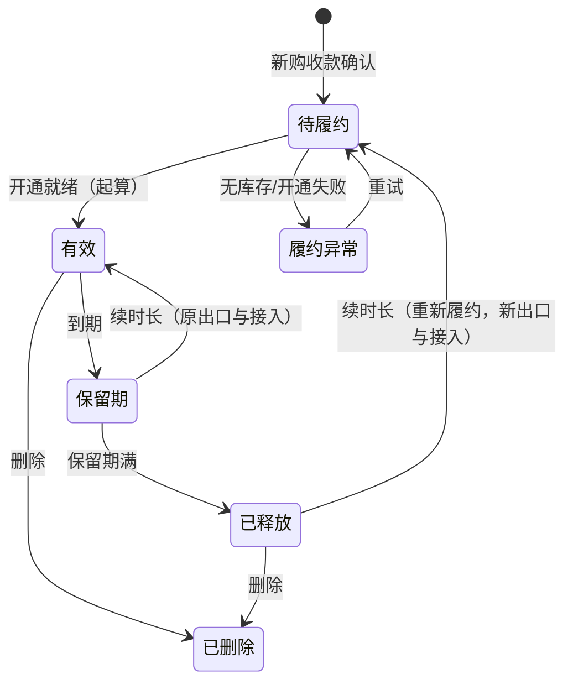

# ISP 代理服务平台需求文档

版本：0.3。日期：2026-11-07。项目：`isp-proxy`。

状态：需求完善阶段。0.3 相对 0.2 的主要变化：

1. 权益不再绑定代理连接。用户购买的是 **IP 订阅**，它持有时长和流量；**接入**（客户连接）和**出口**（ISP 上游）是挂在订阅下、可独立更换的两层（R-04、R-11）。
2. 主人确认采纳 0.2 评审建议：有上限的透支、单调累计计量、30×24 小时包月、平台内独享出口、到期保留与重新履约、首期分两批交付、后端使用 Go 等（第 12 节）。
3. 收敛重复表述：权益规则只在 R-18 规则表中定义一次，其他章节引用；补充状态优先级（第 7 节）。

本文描述目标行为，不代表 GOST 原生支持或本项目已经实现。执行层方案见 [计量与执行方案](04-计量与执行方案.md)。

## 1. 背景与目标

客户端不能稳定直连第三方美国 ISP 代理，需要一台客户端可达、同时能访问 ISP 上游的服务器中转。中转服务器地域不限，以双向实际可达为准。

在此基础上建立面向客户销售的 ISP 代理平台：客户在用户前台注册、验证邮箱、登录，购买按 IP 包月、含流量的订阅，管理自己的连接与出口；管理员在管理后台维护上游资源、确认收款、开通服务、监控节点，并处理换出口。

“购买 IP”是购买有期限的代理使用权益，不是购买公网地址所有权。三层模型：

```text
用户
 └─ IP 订阅（subscription，权益载体：时长 + 流量账本，生命周期内身份不变）
      ├─ 接入（access）：域名、三种协议端口、连接用户名/密码 —— 可更换（连接泄露时）
      └─ 出口（exit binding）：ISP 上游资源 → 实际出口 IP —— 可更换（换 IP）
```

核心链路：

```text
客户程序 → 接入（平台入口 + 凭据）→ 订阅（准入、计量、停用）→ 出口（ISP 上游）→ 目标网站
                                        ↑
                          时长权益 / 流量账本（按订阅）
                                        ↑
                          用户前台 / 业务 API / 管理后台
```

成功标准：

- 用户完成邮箱验证后可独立下单，并管理自己的订阅、接入和出口。
- 管理员无需手写 GOST 配置即可交付带独立认证、指定出口、包月有效期和独立流量额度的订阅。
- 订阅有效期内，用户可以只换接入、只换出口或两者都换，时长与流量保持不变。
- 收款只入账一次；流量耗尽或订阅到期都在规定时延内停止全部转发。
- 监控异常、开通失败、换接入/换出口失败都有可追踪状态。

## 2. 原始需求与范围摘要

### 2.1 主人原始需求

- 使用 GOST v3，基于上游 fork 建立独立项目；中转服务器地域不限，出口默认美国 ISP。
- 支持 HTTP、HTTPS、SOCKS5；同时具有管理后台和用户前台。
- 可查看每个订阅的连接、流量和实际出口 IP。
- 每个订阅独立计算流量；可买流量，用完即停止转发。
- 前期人工录入 ISP 上游，系统自动生成客户连接。
- 考虑以后对外服务，不限定为个人工具。
- 2026-11-07 补充：用户自助下单、管理员人工核款；按 IP 包月、套餐含流量；邮箱密码登录（含验证与找回）；时长与流量独立续购，任一用尽停用；流量长期保留、不按月清零。
- 2026-11-07 补充：权益不与代理连接绑定。订阅有效期内，用户可只换连接（出口不变）、只换出口（连接不变），或两者都换。

已确认的决策汇总于第 12.1 节，不在正文重复罗列。

### 2.2 交付范围

首期（D-08 双端同时交付）分两批完成，第二批完成才算首期交付：

| 批次 | 内容 | 出口条件 |
| --- | --- | --- |
| P0a 收费闭环 | 管理后台；管理员代建用户与订阅；人工核款与开通；三种协议接入；按订阅计量；耗尽/到期强制停用；续时长/买流量；换接入、换出口、组合更换；出口检测；基础指标；审计 | 第 10 节的计量、停用、更换类验收通过，才允许收费 |
| P0b 用户自助 | 用户前台与邮箱账号；套餐展示与自助下单；库存预留；用户自助换接入；换出口申请；告警事件；手机适配 | 账号、越权、下单与库存类验收通过 |

后续 P1：在线支付及回调、自动退款、供应商采购/换 IP API、多节点调度与扩容、客户端 IP 白名单认证、同用户订阅间流量划转的自助操作。

首期不承诺：自动采购 ISP、无上游资源时自动生成地址、任意供应商一键换 IP、抓取代理池、轮询随机出口、解密客户 HTTPS、SOCKS5 UDP、跨订阅共享流量、自动扣款续费、TCP 会话无损迁移。

## 3. 术语与角色

### 3.1 术语

| 术语 | 定义 |
| --- | --- |
| 用户 | 平台客户身份，可持有多个订阅 |
| IP 订阅 | 用户购买的权益载体，具有稳定的 `subscription_id`；持有时长权益和流量账本；前台显示为“我的 IP” |
| 接入 | 订阅当前的客户连接：域名、HTTP/HTTPS/SOCKS5 三个端口、连接用户名和密码。有版本号；同一时刻每个订阅只有一个生效版本 |
| 出口绑定 | 订阅当前占用的 ISP 上游资源及其配置版本。同一时刻每个订阅只有一个生效版本 |
| 上游资源 | 管理员从供应商获得的代理地址和认证，以资源 ID 管理；公网出口地址不能作为唯一库存标识 |
| 实际出口 IP | 经完整链路访问受控检测端点时，目标侧观察到的公网 IP |
| 套餐 | 销售商品：地域、协议、独享属性、包月时长、包含流量、并发连接上限、带宽上限、价格和交付规则 |
| 时长权益 | 订阅的服务起止时间 |
| 流量账本 | 购买、赠送、补偿、扣回等入账事实，以及单调累计的已用量；它是余额的权威来源，监控图表不是 |
| 换接入 | 为订阅签发新接入，立即撤销旧接入；出口、时长、流量不变 |
| 换出口 | 为订阅切换到新上游资源并验证出口；接入、时长、流量不变 |
| 组合更换 | 一次操作同时换接入和换出口 |
| 中转节点 | 承载 GOST 转发的服务器，与控制台可同机或分离 |

### 3.2 角色

- 访客：查看公开套餐、注册、验证邮箱、登录、找回密码；不能获取任何连接或供应商凭据。
- 客户：购买、续购和管理本人订阅；自助换接入；申请换出口；查看时长、流量、订单和申请结果。
- 管理员：管理套餐、库存、节点、用户和订阅；确认收款、开通、调整权益、换出口、暂停与恢复、处置异常。
- 系统：认证、订单与权益、配置下发与核实、出口检测、计量、执行期限和额度、审计。

管理员权限、客户权限与 GOST 内部管理凭据三者分离；客户不能用 GOST 管理账号登录业务产品。

## 4. 已确认的关键默认值

| 项目 | 规则 | 来源 |
| --- | --- | --- |
| 流量口径 | 认证成功的连接上的全部应用层字节，上下行合计，含代理协商字节（通常不足 1 KB）。HTTPS 入口按 TLS 解密后计；认证失败的连接、平台 TLS 封装、TCP/IP 开销不计。1 GB = 1,000,000,000 字节 | D-03 |
| 透支上限 | 每次耗尽事件每订阅透支不超过 1,000,000 字节（2026-11-07 按原型结果冻结） | D-17 |
| 停用时延 | 耗尽、到期、撤销接入或暂停发生后，该范围内全部连接 ≤ 1 秒关闭（2026-11-07 按原型结果冻结） | D-17 |
| 崩溃损失 | 进程或节点崩溃时，最多少计一个持久化间隔（≤ 1 秒）的用量，由平台承担；不得多扣客户 | D-17 |
| 写失败偏差 | 下行字节先授权计入再写出；底层写失败时这部分已计入但未送达，每次失败最多多计一个写块。主人接受这一有界偏差，不要求严格“成功写出才计” | D-17、04 G-3 |
| 包月时长 | 1 个月 = 30 × 24 小时，以 UTC 存储；展示按用户时区（默认 Asia/Shanghai） | D-03 |
| 独享 | 平台内独享出口：一个上游资源同一时刻只分配给一个有效订阅 | D-13 |
| 部署规模 | 首期单中转节点，每个订阅只有一个权威活动实例；数据模型保留节点身份 | 默认建议，具体规模见 D-06 |
| 传输范围 | 三种入口都支持 TCP；SOCKS5 UDP 不在首期 | — |
| 下单粒度 | 一次订单一个订阅；用户可多次购买 | D-13 |

## 5. 核心功能需求

### R-01 中转与固定出口

1. 客户只接触平台入口，目标网站经订阅当前的出口绑定访问。
2. 不同订阅可绑定不同上游；每个上游资源同一时刻只分配给一个有效订阅（D-13）。
3. 上游失败必须显式失败，不得改为中转服务器直连或换到其他 ISP。
4. 默认目标为美国 ISP，可指定其他国家。地域和 ISP 属性分别展示“供应商声明”和“检测结果”。
5. 共用一个中转域名，每个接入版本占用独立端口（每协议一个），端口分配见 R-04。

### R-02 HTTP / HTTPS / SOCKS5

1. HTTP 入口支持普通 HTTP 转发和 CONNECT。
2. HTTPS 入口指客户端与平台之间先建立 TLS，再传输 HTTP/CONNECT；必须有可信证书和匹配域名。证书不满足时该入口不得就绪，不能静默降级。
3. SOCKS5 首期支持用户名密码认证的 CONNECT，目标为域名和 IPv4；IPv6 视节点和供应商能力展示。未支持的命令明确返回失败。
4. 同一订阅的三种入口共用同一份额度，流量合并统计，同时保留按入口拆分的视图。
5. 不要求客户安装中间人根证书，不解密目标站 HTTPS 正文。

### R-03 人工录入与自动开通

1. 管理员录入上游资源：支持粘贴 `socks5://<user>:<password>@<host>:<port>`、`http://...`、`https://...`，也可逐字段录入；正确处理 URL 编码凭据、域名和 IPv6。
2. 录入后，系统从所选节点验证上游认证、连通性和实际出口，通过后资源进入“可售”。
3. 开通即为订单所属订阅分配可售资源，签发首个接入，生成并下发配置，再经完整链路核实。只有接入就绪且出口验证通过后，才显示“已就绪”并起算时长。
4. 开通、下发、验证的每一步都有状态和失败原因；失败时回收本次分配的端口和资源，或明确进入待清理，不影响其他订阅。
5. 重复提交同一开通请求，不得生成多个订阅或接入、重复入账或重复占用资源。
6. 成功后可复制三种协议的客户连接；上游凭据不得出现在客户连接中。

示意输出，不含真实凭据：

```text
http://<access_user>:<access_password>@proxy.example.com:<http_port>
https://<access_user>:<access_password>@proxy.example.com:<https_port>
socks5://<access_user>:<access_password>@proxy.example.com:<socks_port>
```

### R-04 订阅、接入与凭据（含换接入）

1. `subscription_id` 在订阅生命周期内不变，换接入、换出口、续购、重启、升级都不改变它。订阅只属于一个用户，不同订阅的余额和消费互不混算。
2. 每个订阅同一时刻只有一个生效接入版本。每个接入版本由“三个协议端口 + 连接用户名 + 连接密码”组成，凭据随机生成，与登录密码、上游凭据都无关。
3. 换接入的两种形式：
   - **重置密码**：端口和用户名不变，签发新密码；
   - **更换接入**：签发新的端口组、用户名和密码。适用于连接泄露、端口被扫描等情况。
4. 换接入生效后，旧接入立即失效：旧凭据被拒绝，旧端口停止监听，旧接入上的存量连接在停用时延内关闭（第 4 节）。不设新旧并存的宽限期。
5. 换接入不改变出口、时长、流量余额和累计消费；用量历史按接入版本标注。
6. 被释放的端口进入冷却期（默认 7 天，D-18），冷却期内不分配给任何订阅；冷却期后再分配时，旧凭据不可能命中新订阅。
7. 客户可在前台自助换接入（P0b）；管理员可代为操作（P0a）。客户自助的频率上限默认每订阅每 24 小时 5 次（D-18），超过时提示稍后再试。
8. 前置条件：订阅生命周期为“有效”或“保留期”（R-18 状态图）。流量耗尽不妨碍换接入，换完仍因耗尽停用。已释放的订阅没有接入可换，续时长重新履约时自动获得新接入和新出口。用户封禁或管理员暂停时，客户不能自助换接入，管理员仍可操作。
9. 普通页面和日志隐藏密码；查看或复制明文连接需要服务端授权，记录操作但不记录明文。
10. 平台禁止无认证的公网入口。

### R-05 出口检测与可用状态

1. 从承载节点经当前出口绑定检测真实出口；不能把供应商入口 IP 或中转公网 IP 当作出口。
2. 展示出口 IPv4/IPv6、国家/地区、可获得的 ASN/运营商、检测时间、耗时和失败原因；ISP/住宅分类没有可追溯来源时显示“未知”。
3. 开通、换出口后立即检测；支持手动检测和有预算的定时检测。
4. 检测失败时保留上次结果和时间，明确标注过期或失败。
5. 检测流量与客户消费分开记账；内部探测走平台内部身份，不提供客户可设置的免计费标志。

### R-06 连接与流量观察

1. 按订阅展示当前连接数、历史连接数、上传、下载、累计消费、可用余额和实时速率；可按接入版本、出口版本、协议拆分。
2. 管理员可查看活动连接的协议、来源、目标主机/端口、接入版本、出口版本、开始时间和收发字节，并可断开指定连接。
3. 速率和活动连接建议 5 秒内更新；扣量和停用执行不依赖页面刷新。
4. 客户只看本人订阅的汇总用量和状态，不看管理端原始连接日志。
5. 账务持久保存，重启不清零。流量趋势保留 90 天，连接明细保留 7 天（D-07 建议值）。

### R-07 计量口径

1. 按第 4 节口径，以整数字节累计，不按请求四舍五入。
2. 只计量认证成功的连接。未认证、认证失败的连接产生的字节不扣任何订阅，防止知道端口的第三方消耗客户流量。认证成功的连接从第一个字节起全部计入，处理器在认证前预读的请求正文也不例外。
3. 每个订阅维护单调递增的累计已用量 `used_total`；数据面上报累计值而非增量，控制面只接受更大的值，因此重复上报、乱序和重放天然幂等。
4. 已成功转发的部分，即使之后连接失败也计量；客户重试按实际传输计量；平台不自动重放非幂等业务。
5. 供应商账单和服务器网卡流量另行统计，不替代客户消费账本。
6. 计量口径在销售页和订单快照中向客户展示。

### R-08 额度与耗尽强制停止

1. 每个订阅的可用余额 = 净入账总额 `entitled_total` − 累计已用 `used_total`。`entitled_total` 只由流量账本条目求和得出，不能直接写余额字段。
2. 同一订阅的多协议、多连接共享同一额度计数，不得每个连接各自缓存可重复花费的余额。
3. 数据转发前按剩余额度授权字节，接近零时缩小授权；单次耗尽事件的透支不超过第 4 节上限。
4. 耗尽时停止授权新字节，拒绝新连接（明确失败，不挂起），并在停用时延内关闭该订阅的全部存量连接，包括空闲长连接。
5. 不允许“每隔几秒看一次指标再禁用”的模式。
6. 无法可靠记录消费（如持久化失败）时，停止该节点新的字节授权并告警。
7. 崩溃恢复以最后持久化的 `used_total` 为准，少计部分由平台承担（第 4 节）；不设需要人工核对的“在途保留”状态。
8. 控制面调整额度只能追加账本条目，从而改变 `entitled_total`；任何路径都不能覆盖或回退 `used_total`。
9. 耗尽原因记为可查询状态，界面显示“流量已用完”，其他订阅不受影响。

### R-09 订单、入账与账务

1. 订单类型：新购、续时长、买流量、含流量续费。保存客户、套餐、价格版本、时长增量、字节增量、金额、币种、支付方式及状态快照。续购类订单绑定已有订阅；新购在开通时创建订阅。
2. 用户自助下单，管理员人工确认收款。只有已确认收款且满足履约条件的订单才入账；客户提交的“已支付”字段不改变收款状态。
3. 人工确认记录外部收款参考、操作人和时间；确认与入账以订单号为唯一业务键，可恢复且只执行一次。并发点击、超时重试、未来的支付回调重复投递，都不能重复入账。
4. 流量只进入目标订阅。管理员赠送、补偿、扣回作为独立账本条目，记录原因和操作人，不能覆盖余额或删除历史。
5. 金额以最小货币单位整数存储，字节以 64 位无符号整数存储，不使用浮点。
6. 首期不自动退款；退款走独立流程，明确已消费部分与剩余可回收权益。不能删除已支付订单来伪造退款，不能制造负余额继续消费。
7. 将来接在线支付时，必须以服务端校验过的回调和渠道订单状态为准，浏览器跳转不能作为到账凭据。
8. 收款状态、履约状态和入账状态分开记录。已收款但无库存或开通失败时，显示“已收款，交付异常”及处置进度。
9. 订单成立时展示并保存规则：时长增量、流量增量、起算方式、独享、流量长期保留、换接入与换出口政策、人工确认说明；套餐编辑或下架不追溯修改已购权益。

### R-10 暂停、恢复、到期与释放

1. 恢复条件见 R-18；补购任何一项都不能解除管理员暂停、用户封禁、删除或变更中等独立阻断。
2. 管理员暂停立即拒绝新连接并在停用时延内关闭存量连接；恢复前核对额度、节点、上游和入口就绪。
3. 到期后进入保留期（默认 7 天，D-14）：保留原出口资源和接入，停止转发。保留期内续时长，恢复原出口和原接入。
4. 保留期满：释放出口资源，撤销接入，订阅进入“已释放”。剩余流量和历史保留在订阅上，不清零、不没收。
5. 已释放订阅续时长等于**重新履约**：分配新出口资源、签发新接入，就绪后起算时长，原流量余额原样可用。下单前必须提示“出口 IP 会变化”；无库存时进入待履约，不收取停用空档。
6. 管理员可把已释放订阅的剩余流量全额划转到同一用户的另一个订阅（首期仅管理员操作），以成对账本条目记录，原订阅余额归零并标注去向。
7. 删除订阅停止所有入口、撤销凭据、释放资源，保留订单和消费历史；有剩余付费流量时先提示并进入人工处置，不得静默没收。
8. 用户自助暂停为建议能力，不顺延期限；条款下单前披露。

### R-11 换出口与组合更换

1. 首期由管理员为订阅选择或录入新的上游资源；用户可在前台提交换出口申请（P0b）。供应商换 IP API 后续接入。
2. 切换前验证新资源可达、认证有效、国家符合，并取得实际出口 IP。验证失败时保持原绑定和服务状态。
3. 新出口必须与原出口不同，也不能是平台内其他有效订阅当前的出口（D-13）。地址相同只能报告“上游已更新，出口未变”，不能报告成功。
4. 切换成功后，订阅、接入、时长、流量和累计消费不变；记录新出口版本和检测时间。原资源进入隔离或回收，不立即转售给他人（冷却期同 D-18）。
5. 切换提交后关闭经旧出口的存量连接，新连接只走新出口；明确告知现有连接会断开。
6. **组合更换**：新接入直接绑定新出口上线，旧接入和旧出口同时下线。任一步失败则整体回到原状态，不出现“新接入走旧出口”或“旧接入走新出口”的中间态。
7. 换出口、换接入、续购、耗尽、暂停并发时，最终启用状态仍须同时满足 R-18 的全部条件；失败和重试不能产生两条同时有效、都在扣量的通道。
8. 前置条件同 R-04.8。换出口的次数、间隔和收费规则见 D-19；首期默认每订阅每 30 天免费 1 次，超出由管理员人工决定。
9. 供应商不支持原地换 IP 时，界面明确要求替换上游资源。

### R-12 管理后台

| 页面 | 最少信息与操作 |
| --- | --- |
| 运营概览 | 订阅总数、可用/耗尽/到期/暂停/异常数，当前连接、速率、今日及累计流量，待核款、待开通 |
| 订阅列表 | 用户、名称、当前接入、实际出口与检测时间、到期时间、流量余额、累计消费、主状态及全部阻断原因 |
| 订阅详情 | 时长与流量账本、接入版本历史、出口版本历史、活动连接、流量趋势、订单；换接入、换出口、组合更换、暂停/恢复、调整权益 |
| 开通 | 从订单开通或代建：选择用户、节点、可售资源，核实、生成连接 |
| 用户管理 | 邮箱、验证/账号状态、订阅、订单；封禁时撤销会话并停用其全部订阅；不显示登录密码 |
| 套餐与库存 | 价格、流量、并发/带宽上限、上下架；资源待验证/可售/已预留/已占用/冷却/隔离/停用状态 |
| 订单与账务 | 四类订单、人工确认、履约异常、退款处置、赠送/调整/划转、对账 |
| 换出口申请 | 申请原因、候选资源验证、当前与候选出口比较、执行进度、结果 |
| 节点与监控 | 节点地址、能力、在线情况、配置版本、端口占用；R-19 指标与告警 |
| 审计 | 开通、暂停、换接入、换出口、收款确认、权益调整、划转、凭据查看 |

普通列表不展示明文密码；异常不只用颜色表达；“配置已保存”“数据面就绪”“可销售”分开显示。

### R-13 隔离、安全与合规

1. 管理员与客户身份分离；所有读写和凭据查看都在服务端检查授权，不能只靠前端隐藏。
2. 猜测他人订阅、接入、连接、订单或账务 ID，不能读取或操作；过滤和导出按用户范围执行。
3. 上游密码和可恢复的接入密码加密保存，登录密码单向散列；密钥不进 Git、日志或普通列表响应。验证、找回和会话材料按敏感凭据处理。
4. 控制台和业务 API 使用 HTTPS；GOST 管理面只允许内部访问，客户不能直接改原生配置。
5. 公网入口具备认证防爆破、每订阅并发连接上限和带宽上限（套餐属性）、管理员停用和滥用处置能力。
6. 默认禁止的出站目标：25 端口（SMTP）、私网、环回、链路本地、云元数据地址；例外须管理员明确授权并审计。
7. 不解密客户业务，不默认记录完整 URL 路径、请求头或正文；连接元数据的访问和留存有明确范围。
8. 封禁、凭据撤销、换接入对存量连接同样生效。
9. 前台和后台只经平台业务 API 操作，不直连 GOST 管理 API 或 Prometheus。
10. **对外销售前的合规门槛**（D-20）：运营主体所在地法规评估、上游供应商使用条款、是否需要 KYC、可接受使用政策（AUP）、滥用投诉处理流程、隐私告知。未完成前只做内部或受邀测试。

### R-14 可靠性与恢复

1. 配置、归属、订单、账本、累计用量、接入与出口版本历史跨重启保存，有备份和恢复流程。
2. 配置下发有版本和结果回执；端口冲突、证书失败、节点离线、部分失败有确定状态，可重试但不重复业务副作用。
3. 开通、换接入、换出口、续购、暂停的并发修改有版本检查；过时配置不能让已停用订阅重新可用。
4. 首期一个订阅只有一个权威活动实例；将来多节点必须先证明跨节点额度授权，不允许复制余额双活。
5. 节点失联时区分管理面失联与数据面可达；数据面在本地已知额度和期限内自行执行停用，不能把上报中断显示为零流量。
6. 从备份恢复时，`used_total` 取备份值与节点本地持久值中的较大者，不能凭旧快照重新开放已消费的流量。
7. 到期在数据面执行：控制台宕机、浏览器关闭或定时任务延迟，都不能让过期订阅继续转发。节点时钟用 NTP 同步，偏差超过阈值时告警。
8. **补时规则**（D-21 默认建议）：因平台或上游原因，订阅连续不可用超过 1 小时，按实际不可用时长补时；首期由管理员确认后以账本条目记录。

### R-15 邮箱账号与登录

1. 邮箱加密码注册，规范化邮箱唯一。验证前只能完成验证和必要的账号操作，不能购买或获取连接。管理员代建用户也须走邮箱验证和本人设置密码。
2. 验证材料有期限、用途绑定、尝试次数限制，只能成功使用一次；支持重发，旧材料失效规则明确。
3. 登录有明确的错误、限流和封禁提示；找回密码通过邮箱一次性材料完成。公开接口不泄露邮箱是否已注册；发送、注册、登录、找回都有服务端限流。
4. 找回或修改密码后撤销原有会话；会话过期和封禁在服务端生效。
5. 管理员身份由受控流程建立，不开放自助注册或角色修改；管理员可发起重设邮件，不可查看密码或无痕冒用身份。
6. 管理员会话与客户会话分开；登录失败、敏感操作、权限变更有审计；管理员 MFA 在对外上线前确定（D-15）。
7. 登录密码与接入密码各自独立：改登录密码不影响接入，换接入不影响登录密码。邮箱变更和账号合并首期不自助。

### R-16 套餐、库存与自助购买

1. 用户可查看可售套餐，比较地域、协议、包月价格、包含流量、并发/带宽上限和交付规则；不虚构供应商、库存或出口保证。
2. 具体出口在履约时分配，下单前不暗示已锁定某个地址。
3. 库存状态：待验证、可售、已预留、已占用、冷却、异常隔离、停用。分配时检查平台内独占（R-01.2）。
4. 下单时服务端校验套餐可售、价格版本、用户状态和库存；同一资源不能被并发重复出售。未付款订单预留库存 24 小时（D-13 建议值），每用户同时最多 3 个未付款新购订单，超时自动取消并回收。
5. 订单页给出订单号、金额/币种、人工支付说明和状态；用户的“已转账”反馈只是核对线索。
6. 已取消/超时订单遇到晚到款，或确认收款时资源已不可用，进入可审计的人工处置：重新履约或退款。

### R-17 用户前台

| 页面 | 最少信息与操作 |
| --- | --- |
| 账号 | 注册、邮箱验证/重发、登录、退出、找回及修改密码 |
| 套餐选购 | 地域、包月价格、包含流量、并发/带宽上限、库存提示、人工确认与交付说明；创建订单 |
| 概览 | 本人订阅数、各状态数、即将到期、待处理订单 |
| 我的 IP | 名称、实测出口及检测时间、地域、到期时间、流量余额、主状态与全部阻断原因 |
| IP 详情 | 复制三种协议连接；“重置密码”“更换接入”；“申请换出口”（可勾选同时更换接入）；“续时长”“买流量”；时长与流量记录；接入/出口变更历史；改名 |
| 我的订单 | 类型、收款/履约状态、金额、套餐快照、处置进度 |
| 我的申请 | 换出口申请进度、结果与失败原因；不显示管理员内部备注或供应商信息 |

1. 客户不能编辑上游、节点、计费规则、余额或到期时间，不提供 GOST 配置编辑器。
2. 换接入前提示“旧连接会立即失效，正在使用的程序需要更新配置”；完成后展示新连接。
3. 换出口申请：同一订阅已有未完成申请时显示现有进度，不重复提交；切换前提示活动连接会中断。

### R-18 权益规则（唯一定义处）

**规则表**

| 规则 | 内容 |
| --- | --- |
| 权益载体 | 时长和流量都属于订阅，不属于接入或出口；换接入、换出口、组合更换都不改变权益 |
| 首购 | 新购套餐同时提供包月时长和包含流量；时长在首次就绪时起算 |
| 续时长 | 只延长时长，不改流量。有效期内续费接在原到期时间之后；保留期内续费从重新就绪时起算；已释放后续费即重新履约（R-10.5） |
| 买流量 | 只增加流量，不改到期时间；到期订阅也可买，但须提示还要续时长才能使用 |
| 含流量续费 | 订单明确两项增量，两项各自幂等入账，部分失败可见并可补偿 |
| 流量保留 | 长期保留，不按月清零；包月时间边界不是发放流量的事件；到期、释放都不清余额 |
| 可用条件 | 时长有效（已开始且未到期）且可用流量 > 0，且无其他阻断（第 7 节）；任一不满足即拒绝新连接、关闭存量连接 |
| 幂等 | 重复确认、重试、并发续费、重放都不能重复增加时长或流量 |
| 不重置 | 换接入、换出口、检测失败、改名、重启都不改变时长或流量 |
| 调整 | 补时、赠送、退款、划转都是独立账本条目，带原因和操作人 |
| 通知 | 前台展示到期和低流量提示；邮件为建议渠道，阈值见 D-15；通知失败不影响停用 |

**组合矩阵**（其他条件正常时）

| 时长 | 可用流量 | 是否可用及补救 |
| --- | --- | --- |
| 有效 | > 0 | 可用；可提前续时长或买流量 |
| 到期 | > 0 | 不可用；续时长后恢复，余额保留 |
| 有效 | 耗尽 | 不可用；买流量后恢复，到期时间不变 |
| 到期 | 耗尽 | 不可用；两项都补足才恢复 |

**订阅生命周期**



“有效”只表示时长有效；能否实际转发还取决于流量和第 7 节的其他阻断。

### R-19 监控与指标

1. 区分业务概览、订阅健康和节点资源三类：
   - 业务：待核款、待开通、即将到期/耗尽、履约/换出口失败；
   - 订阅：活动连接、速率、业务流量、上游认证/拨号错误、出口检测；
   - 节点：CPU、内存、磁盘、网络、进程存活、配置下发结果。
2. 指标带时间范围、单位、采集时间和新鲜度；采集断联、无数据、真实零值明确区分。监控采样不作为扣量、续期或收款依据。
3. 首期至少有告警事件列表（P0b；P0a 至少有异常页），覆盖：节点离线、上游异常、配置失败、证书风险、计量持久化失败、时钟偏差。
4. 管理员可从异常定位到订阅、节点、任务或订单，再执行授权操作；图表点击不直接改变服务状态。
5. GOST 指标、节点资源和业务指标分别说明来源；节点资源需要部署侧采集。

## 6. 核心业务流程

### 6.1 首次购买与人工履约

注册 → 验证邮箱 → 选套餐 → 服务端校验并预留库存 → 下单，展示人工支付说明 → 管理员核款 → 创建订阅（待履约）→ 分配资源、签发接入、下发、核实 → 就绪并起算 → 用户在“我的 IP”获取连接。

P0a 阶段由管理员代建用户和订单，走同一条订单、入账和审计链路。

### 6.2 续时长、买流量与恢复

选择本人订阅 → 查看到期时间和流量余额 → 选择续时长、买流量或含流量续费 → 下单 → 管理员核款 → 对应权益幂等入账 → 按 R-18 判断可用。已释放订阅续时长进入 6.1 的履约步骤。

### 6.3 换接入（连接泄露）

用户或管理员发起 → 核对归属和前置条件 → 分配新端口组（或只换密码）→ 下发新接入并验证 → 原子切换生效版本 → 关闭旧接入的监听与存量连接 → 端口进入冷却 → 展示新连接、记录审计。出口、时长、流量不变。

### 6.4 换出口与组合更换

用户申请或管理员主动发起 → 核对归属与原因 → 选择或录入候选资源 → 验证并比较真实出口（与原出口不同，且未被其他订阅占用）→ 提交新绑定（组合更换时同时签发新接入）→ 关闭旧出口（及旧接入）的连接 → 经客户入口验证新出口可用 → 更新申请与审计。

已到期、耗尽或暂停的订阅可以由管理员更新上游，但这不会解除原有阻断。

### 6.5 邮箱与账号恢复

注册/重发验证 → 一次性验证 → 允许购买；忘记密码 → 通用结果提示 → 邮箱一次性材料 → 设新密码 → 撤销旧会话 → 重新登录。

## 7. 状态与核心数据

### 7.1 状态维度（互不覆盖）

- 账号：待邮箱验证、正常、封禁；会话另有有效/过期/撤销状态。
- 订单：收款（待核实、已确认、取消、退款核对中、已退款）与履约（待开通、处理中、已交付、失败待处理）两个维度。
- 订阅生命周期：待履约、履约异常、有效、保留期、已释放、已删除（R-18 状态图）。
- 流量：有余额、耗尽。
- 管理意图：启用、暂停。
- 变更任务：无、换接入中、换出口中、组合更换中、失败。
- 数据面：就绪、节点失联、上游异常、证书异常、未知。
- 换出口申请：待处理、处理中、成功、失败、取消。

客户业务可以转发的条件：账号正常、订阅“有效”、流量有余额、管理意图为启用、数据面就绪，且没有阻断转发的变更任务。

### 7.2 主状态展示优先级

列表和卡片只显示一个主状态，同时列出全部阻断原因。优先级从高到低：

1. 账号封禁
2. 已删除 / 已释放
3. 管理员暂停
4. 待履约 / 履约异常
5. 到期（保留期）
6. 流量耗尽
7. 变更中（换接入、换出口）
8. 数据面异常（节点、上游、证书）
9. 可用

### 7.3 必须独立表达的实体

用户与邮箱验证、会话与找回凭证、角色、订阅、接入版本、出口绑定版本、上游资源与库存状态、中转节点、端口分配与冷却、出口检测、活动连接、流量账本条目、累计用量上报、时长变更记录、订单及收款/履约记录、套餐与价格快照、配置任务、换出口申请、告警事件、通知投递、操作审计。

不得把这些概念压缩成一个可以随意修改的“余额字段”或“状态字段”。

## 8. 可行性边界

起点为 GOST `v3.3.3`（提交 `3d514c57230bfa524aa89087da5580b314f1cd36`）。协议实现、配置和统计来自 `github.com/go-gost/x v0.28.1`，接口来自 `github.com/go-gost/core v0.6.1`，见 [go.mod](../go.mod) 和 [上游来源](../UPSTREAM.toml)。

对 `x v0.28.1` 的源码核对和原型验证结论（详见 04 第 2、8 节）：

- `limiter/quota` 在监听器层计量（包含认证失败的字节），写完才累加，空闲连接不会被关闭，过了有效期反而不限制，窗口变化会清零已用量。**不采用。**
- 处理器认证后的 `TrafficLimiter.Wait(n)` 接缝不适合计量：普通 HTTP 转发的首个请求正文会绕过它。改为在本仓的连接表包装连接上计量，认证器回填认证结果。
- 删除服务只关闭监听器，不关闭已建立的连接，因此自建了按订阅的连接表。
- 链缺失或选不出节点时，GOST 会从中转服务器直连目标，违反 R-01.3，因此出口链包装为失败即拒绝。
- 上述能力全部通过本仓注册的组件实现，不需要 fork `x`。原型在本机回环环境通过 S-1～S-10，尚未压测，也未做真实进程崩溃测试。

不能单靠轮询 Prometheus、定时上报、限速或只检查新连接来满足 R-08。

后端使用 Go（D-16），数据库及部署方式见 04。前端见 [前端技术选型](03-前端技术选型.md)。gost-ui 仅作开发调试参考，不 fork。

## 9. 非功能要求

- 账务正确、额度不可绕过、客户隔离优先于吞吐；压测目标按 D-06 规模确定。
- 健康检查失败、账务不可用、计量持久化失败时，不显示成功或零消耗。
- 升级、备份恢复、节点重启保留数据与身份；迁移失败不以删库重建解决。
- 历史消耗不因删除、换接入、换出口或迁移而归零。
- 商业化前补齐运行手册：连接/任务/密钥管理、计量故障、账单、操作审计。
- 用户前台覆盖手机浏览器上的注册、下单、复制连接、换接入和续购；管理后台以桌面为主。键盘可操作、表单标签、错误说明、状态文本属于首期要求。
- 页面区分无数据、加载中、提交中、成功、失败、无权限、数据过期。首期以中文为主，金额、时区和单位明确，保留国际化接入位置。

## 10. 验收与测试策略

逐场景清单见 [需求核对与验收清单](02-需求核对与验收清单.md)。

- 单元和进程内测试优先证明：计量、授权、幂等、状态机、额度竞争。
- 真实数据库专项证明事务和恢复语义。
- 协议互通、出口与字节边界，用**本地 GOST 实例模拟 ISP 上游**，加本地 IP 回显端点完成；不依赖付费上游。
- 新增测试应先失败一次，确认断言可以证伪。

E2E 只在主人明确要求，或事先说明场景、边界与成本并获批准后运行。文档阶段只做一致性检查，不接入付费上游、不发真实邮件、不做真实支付。

## 11. 事实源

- [GOST fork 与起点](../UPSTREAM.toml)
- [上游转发链](https://gost.run/concepts/chain/)
- [HTTP 与 TLS 代理](https://gost.run/tutorials/protocols/http/)
- [SOCKS 协议](https://gost.run/tutorials/protocols/socks/)
- [监控指标](https://gost.run/tutorials/metrics/)
- [服务观测插件](https://gost.run/concepts/observer/)
- [上游 WebUI](https://github.com/go-gost/gost-ui)

## 12. 决策记录

### 12.1 已确认

| 编号 | 主人确认的选择 | 日期 |
| --- | --- | --- |
| D-01 | 首期人工核实收款后入账，在线支付后续接入 | 2026-11-07 |
| D-02 | 首期人工替换 ISP 上游实现换出口，保留客户接入和权益；供应商 API 后续接入 | 2026-11-07 |
| D-03 | 计量：认证成功的连接上的全部应用层字节（含协商）、上下行合计、十进制 GB；包月 = 30×24 小时，UTC 存储 | 2026-11-07 |
| D-08 | 首期同时交付管理后台和用户前台，分 P0a/P0b 两批完成；管理员保留代办能力 | 2026-11-07 |
| D-09 | 邮箱密码登录，含邮箱验证与密码找回 | 2026-11-07 |
| D-10 | 按 IP 包月，套餐含流量 | 2026-11-07 |
| D-11 | 可独立续时长、买流量；时长有效且流量 > 0 且满足其他条件才可用 | 2026-11-07 |
| D-12 | 流量长期保留，不按月清零；到期和释放都不清余额 | 2026-11-07 |
| D-13 | 平台内独享出口；一次订单一个订阅；首次就绪起算 | 2026-11-07 |
| D-14 | 到期后保留期内可续回原出口与接入；期满释放资源，流量保留在订阅上，续时长即重新履约；管理员可在同用户订阅间全额划转 | 2026-11-07 |
| D-16 | 业务后端使用 Go；前端 React 双端，方案见 03 | 2026-11-07 |
| D-17 | 有上限的透支、≤ 1 秒停用时延、崩溃只少扣不多扣；按原型结果冻结为透支 ≤ 1,000,000 字节、停用 ≤ 1 秒；接受下行写失败时最多多计一个写块（G-3）。主人原话：“不需要那么严格，超一些就超吧” | 2026-11-07 |
| D-22 | 权益属于订阅，与接入、出口解耦；有效期内可只换接入、只换出口或两者都换 | 2026-11-07 |

### 12.2 待决策（本稿给出默认建议）

| 编号 | 决策 | 默认建议 | 最晚时间 |
| --- | --- | --- | --- |
| D-04 | 售价、币种、商品规格、赠送和退款规则 | 新购、续时长、流量包、含流量续费四类商品，不预设价格 | 首个收费订单前 |
| D-05 | 供应商能力 | 确认账号并发、绑定 IP、协议、稳定性和换 IP 资源来源 | 接真实 ISP 前 |
| D-06 | 域名、服务器与规模 | 单节点起步；明确订阅数、并发和带宽目标 | 部署与容量设计前 |
| D-07 | 数据留存 | 趋势 90 天、连接明细 7 天；账务长期保存 | 对外服务前 |
| D-14a | 保留期天数 | 7 天 | 冻结期限设计前 |
| D-15 | 邮件服务商、材料有效期、限流、管理员 MFA、提醒阈值 | 管理员强制 TOTP；到期前 3 天和余额低于 10% 时提醒 | 账号设计前 |
| D-18 | 端口冷却期与换接入频率 | 冷却 7 天；自助换接入每订阅每 24 小时 5 次 | 接入设计前 |
| D-19 | 换出口次数、间隔与收费 | 每 30 天免费 1 次，超出人工决定 | 首个收费订单前 |
| D-20 | 对外销售合规门槛 | 按 R-13.10 逐项完成后才对外 | 对外服务前 |
| D-21 | 补时规则 | 连续不可用 > 1 小时按实际时长补，管理员确认 | 首个收费订单前 |
| D-23 | 数据库 | PostgreSQL（见 04） | 后端脚手架前 |

待决策项不得被实现悄悄固化成不可变契约；主人后续裁决优先，并同步更新验收清单。
