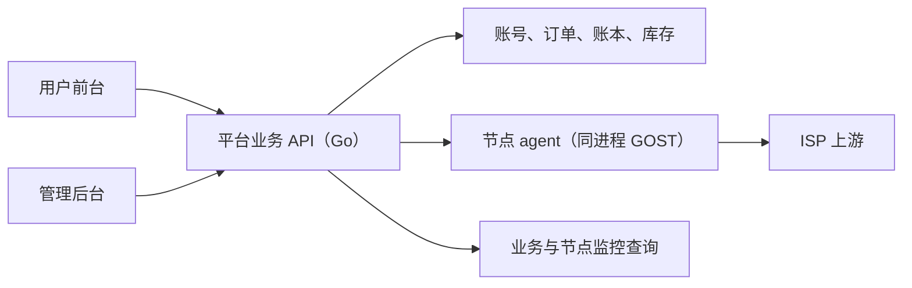

# 前端技术选型：管理后台与用户前台

日期：2026-11-07。对应 [需求文档 0.3](01-需求文档.md)。状态：已采纳评审意见（D-16）。2026-11-07 已按第 5 节版本建成 `web/` 工作区与用户前台原型（`web/apps/portal`，内存模拟数据），类型检查、构建与组件测试通过；管理后台未开始。实施计划见 [施工文档](05-施工文档.md)。

## 1. 推荐结论

新建业务前端，采用 **React + TypeScript + Vite + React Router（Data 模式，纯 SPA）+ Ant Design**。管理后台和用户前台使用同一技术体系，分别设计页面、路由、权限与会话边界。

补充库按职责引入：

- TanStack Query：服务端数据的**唯一**加载与缓存路径；路由层不使用 loader 取数，避免两套缓存。
- Ant Design Form：表单。
- Apache ECharts：监控和用量趋势。

不引入 Refine、Ant Design Pro 全套脚手架或第二套 UI 库。业务后端使用 Go（D-16），见 [计量与执行方案](04-计量与执行方案.md)。

0.2 稿推荐的是 React Router Framework 模式。改为 Data 模式的原因：两端都是登录后的纯 SPA，Framework 模式的类型化路由和自动拆包收益有限，却带来构建期预渲染的约束（模块初始化时不能访问 `window`），并且它的 loader 与 TanStack Query 形成两条重叠的数据路径。Data 模式（`createBrowserRouter`）配合 `React.lazy` 足以实现按路由拆包。

## 2. gost-ui 是否有必要 fork

**不 fork gost-ui。现有 GOST CLI fork 继续保留，两件事分别判断。**

| 对象 | 本项目的用途 | 建议 |
| --- | --- | --- |
| GOST CLI fork（本仓库） | 转发内核，以及同进程的节点 agent（04） | 保留 |
| go-gost/x 与 core | 协议、配置、统计实现与接口 | 按 04 第 8 节门槛决定是否 fork |
| gost-ui | 直连 GOST API、管理原生配置 | 仅作本地调试参考 |
| 新业务 Web | 账号、套餐、订阅、接入、出口、订单、监控、人工履约 | 新建 |

gost-ui 通过 API 地址和可选认证直连 GOST，动态编辑配置。本地检查的版本 `b956f5ee76cea2c463994aa098d8664fd5377bcc` 中，`src/utils/server.ts` 与 `src/Pages/Manage.tsx` 的页面都围绕 GOST API 会话和 Services/Chains/Hops 组织。这是内核配置工具的模型。[上游说明](https://github.com/go-gost/gost-ui)

本项目的核心对象是用户、订阅、接入版本、出口版本、订单、两类权益、库存和审计。沿用 gost-ui 的结构需要替换核心模型、登录、数据权限和大部分交互，复用收益不足以抵消长期同步 fork 的成本。更重要的是访问边界：两端都只访问平台业务 API，不能保留直接修改内核配置的能力。



本地 `18082` 端口的上游工具继续作为开发辅助，不称为本项目的管理后台。

## 3. 用业务需求约束选型

| 需求 | 前端需要的能力 |
| --- | --- |
| 邮箱登录、验证与找回 | 独立认证页、表单校验、过期/限流反馈、会话失效处理；安全判断在服务端 |
| 买 IP、人工核款、人工交付 | 套餐、订单快照、收款与履约两个状态、异常处置，不只是 CRUD 表格 |
| 时长和流量独立购买 | 同屏分别展示到期时间和流量余额，分别提供“续时长”“买流量”，两个阻断同时可见 |
| 权益与接入、出口解耦 | IP 详情里接入、出口、权益分区展示；“重置密码”“更换接入”“申请换出口（可同时换接入）”是三个独立动作；展示版本历史 |
| 换接入是破坏性操作 | 二次确认、明确提示旧连接立即失效；完成后直接展示新连接并引导复制 |
| 流量长期保留、幂等入账 | UI 只读权威值与历史，不自行结算、不乐观增加权益 |
| 管理员换出口 | 验证、比较出口、执行、轮询任务结果；提交成功与执行成功分别反馈 |
| 指标 | 时间范围、筛选、趋势、单位、采集时间，过期/无数据与零值区分 |
| 用户隔离 | 缓存按用户隔离、退出清理；后端再检查角色和资源归属 |
| 手机购买与桌面运维 | 用户前台适配窄屏（见下）；管理后台支持复杂列表 |

**手机适配**：Ant Design 以桌面为主。用户前台的关键页面（登录、选购、我的 IP、IP 详情、订单）要按窄屏单独设计布局，表格改卡片列表，避免直接使用 `Table`；对复制连接、换接入、续购这几项任务，在脚手架阶段做手机原型验证。如果验证效果不可接受，再评估在用户前台引入 antd-mobile（只用于用户前台，不与后台混用）。

## 4. 框架和组件方案比较

| 方案 | 能复用什么 | 取舍 | 结论 |
| --- | --- | --- | --- |
| Vite + React Router Data 模式 + Ant Design | 成熟的路由、表单、列表、反馈控件 | 自行组织业务流程和后台布局；纯静态部署 | **首选** |
| React Router Framework 模式 + Ant Design | 另有类型化路由模块、自动拆包、SSR 选项 | 构建期预渲染约束；loader 与 TanStack Query 重叠 | 不采用（0.2 稿首选，已调整） |
| Ant Design Pro / Umi + ProComponents | 后台布局、ProTable 等高级组件 | 需接受整套约定；ProComponents 的 peer 依赖不含 antd 6 | 暂不引入 |
| Refine + Ant Design | 数据/认证/权限 provider、CRUD hooks | 复杂业务命令仍需自写；Ant Design 集成的 peer 依赖为 antd 5 | 暂不引入 |
| Next.js + Ant Design 或 shadcn/ui | 完整框架，支持服务端能力和静态导出 | 当前不需要以 SSR/RSC 为中心；公开营销/SEO 需求出现后再评估 | 暂不采用 |
| Vite + React + shadcn/ui | 可修改的组件源码，视觉自由度高 | 需自行维护表单、表格方案和组件升级 | 需要专属设计系统时再考虑 |

管理后台的列表页较多。放弃 ProTable 意味着要自行封装一个带筛选、分页、列配置的表格组件，这部分工作量计入后台的第一个迭代。

参考：[React 建议](https://react.dev/learn/creating-a-react-app)、[React Router 模式](https://reactrouter.com/start/modes)、[Ant Design](https://ant.design/docs/react/introduce/)、[Refine 集成](https://refine.dev/core/docs/ui-integrations/ant-design/introduction/)、[Ant Design Pro](https://github.com/ant-design/ant-design-pro)、[Next.js 静态导出](https://nextjs.org/docs/app/guides/static-exports)、[shadcn/ui](https://ui.shadcn.com/docs)。

## 5. 依赖分工与版本核对

| 职责 | 选择 | 使用约束 |
| --- | --- | --- |
| UI 与类型 | React 19、TypeScript 稳定版 | 两端共享版本；TS 版本在脚手架阶段按 peer 范围确定 |
| 路由与构建 | React Router 8（Data 模式）、Vite 8 | 不使用路由 loader 取数；按路由 `lazy` 拆包 |
| 组件与表单 | Ant Design 6、Ant Design Form | 同一套主题 token；两端分别实现布局 |
| 服务端数据 | TanStack Query 5 | 唯一数据路径；查询键包含用户身份和筛选条件；退出时清缓存 |
| 趋势图 | Apache ECharts 6 | 按需引入；标注指标来源、单位和数据时间 |
| API 契约 | 后端 OpenAPI 生成 TypeScript 类型和轻量客户端 | 契约由 Go 后端产出；密码、库存、账务判断都在后端 |
| 工程管理 | pnpm workspace | 见第 6 节，首期保持精简 |
| 验证工具 | Vitest、React Testing Library、按需 MSW | 覆盖权限失效、双权益阻断、换接入确认、重复提交、失败反馈 |

2026-11-07 用 `npm view` 核对的快照，仅作兼容性证据，**不代表已安装或组合构建通过**：

| 包 | 稳定版本 | 相关约束 |
| --- | --- | --- |
| `react` | 19.3.1 | 满足 React Router 的 React 下限 |
| `react-router` | 8.5.1 | React ≥ 19.2.7；Data 模式无需 `@react-router/dev` |
| `vite` | 8.3.6 | Node `^20.19.0` 或 `>=22.12.0` |
| `antd` | 6.7.0 | React/ReactDOM ≥ 18 |
| `@tanstack/react-query` | 5.107.1 | React 18 或 19 |
| `echarts` | 6.1.0 | 按实际使用检查包体 |
| `@refinedev/antd` | 6.0.3 | `antd` peer 仍为 `^5.23.0` |
| `@ant-design/pro-components` | 2.8.10 | `antd` peer 为 `^4.24.15` 或 `^5.11.2`，不含 6 |

可通过 `npm view <包名> version peerDependencies engines --json` 重查。实施时保存锁文件并重新检查；不强行忽略 peer 冲突。本机 Node `22.22.0` 满足下限，但尚未做组合验证。

## 6. 工程与部署边界

首期目录（`apps/portal` 与 `packages/api-client` 已创建，`apps/admin` 未创建）：

```text
web/
  apps/
    portal/       用户前台
    admin/        管理后台
  packages/
    api-client/   由 OpenAPI 生成的类型与请求基础
```

首期只抽出 `api-client`。主题 token、时长/流量/金额格式化等共享代码先放在 `api-client` 旁的一个小包里，或在两端各写一份；等出现真实重复后再抽 `ui` 包，不预先设计共享组件库。

部署：

- 用户前台：`https://<主域名>/`。
- 管理后台：**独立子域名** `https://admin.<主域名>/`，从首期开始就分开。这样会话 Cookie 和 CSRF 防护天然隔离，管理后台还可以单独加 IP 白名单或放在 VPN 后。
- 业务 API 通过反向代理与各自前端同源接入（如 `/api`），避免跨域；两端使用不同的 Cookie 名和作用域。
- 静态服务器为两个 SPA 分别配置深层路由回退。

后台代码不打包进用户应用；共享 API 类型不等于向用户暴露管理员数据。会话使用后端可撤销的机制：HttpOnly、Secure Cookie，配合 SameSite 和 CSRF 防护。不沿用 gost-ui 的“输入 GOST API 地址和 Basic Auth”登录方式。

后端返回当前身份、服务端时间、到期时间、可用流量、全部阻断原因、允许的动作和任务状态。前端只做展示，不以本地时钟或隐藏按钮执行付费规则。

读请求可受限重试；确认收款、换接入、换出口、续时长、买流量必须携带业务幂等键，不当作普通请求自动重放。前端不乐观显示余额增加、收款成功、出口已切换或新接入已生效，一律提交后查询服务端结果。

## 7. 两端页面与关键交互

用户主导航：“概览、购买 IP、我的 IP、订单、申请、账号”。IP 详情页分三个区块：

1. **权益**：到期时间、流量余额、主状态与全部阻断原因、“续时长”“买流量”。
2. **接入**：三种协议的连接、复制、“重置密码”“更换接入”、接入版本历史。
3. **出口**：实测出口与检测时间、“申请换出口”（可勾选同时更换接入）、出口版本历史。

换接入的确认框写明“旧连接立即失效，正在使用的程序需要更新为新地址”。完成后直接展示新连接。

管理员主导航：“运营概览、订阅、上游库存、套餐、用户、订单、换出口申请、节点与监控、审计”。换出口采用“候选录入 → 验证 → 比较出口 → 提交 → 查询执行结果”的流程，不把长任务做成一次保存提示。

两端使用同一套时长、字节、币种格式和状态词（主状态优先级见需求 7.2 节）。必备界面状态：无订阅、无库存、待邮箱验证、待核款、已收款未交付、到期（保留期）、已释放、耗尽、两项都不足、变更中、任务失败、会话过期、无权限、指标过期、采集失败。用户前台视觉方向已定为“SIM 卡与套餐余量”，设计系统见仓库根目录 `DESIGN.md`；品牌名未定，原型用占位名“ISP 代理”。管理后台沿用同一组 token，布局另行设计。

## 8. 实施顺序

1. 计量原型通过（04 第 8 节），冻结 D-17 指标。（已完成，2026-11-07）
2. 冻结 Go 后端 schema 和最小 OpenAPI 契约。
3. 创建 `web/` 脚手架，锁版本，验证依赖、类型、构建；做用户前台关键页面的手机原型。模拟数据须明确标注。（已完成：`web/apps/portal`，手机宽度 390 下关键任务可用，未引入 antd-mobile）
4. P0a：管理后台全部收费闭环页面。
5. P0b：用户前台、自助下单、换接入、换出口申请。

目前只有用户前台原型（模拟数据）；没有开发管理后台、发送邮件、接入支付、验证真实 ISP 或运行 E2E。
