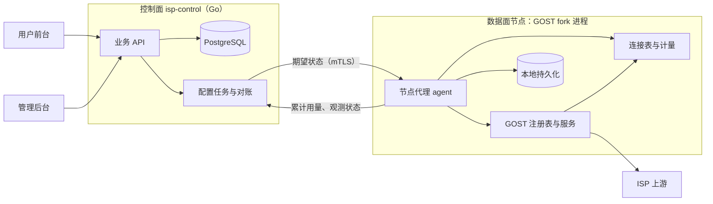

# 计量与执行方案

日期：2026-11-07。对应 [需求文档 0.3](01-需求文档.md)。状态：计量原型已在本机回环环境通过（第 8 节）；M0 原型补齐（真实崩溃、压测基线、并发与带宽上限、出站封禁、出口检测、证书热更新、时钟偏差，2026-11-08）已完成；M3 agent 转正（节点运行时、`gost -agent-config`、期望状态对账、上报、探测、本地状态恢复，2026-11-08）已完成，用伪控制面与伪上游验证（8.2）。尚未与真实控制面实现联调，未接真实 ISP 或多机部署。

本文回答需求第 8 节的问题：如何按订阅精确计量、先授权后转发、在规定时延内关闭全部连接、执行到期，以及崩溃和并发时如何不重复、不多扣。前端见 [03](03-前端技术选型.md)。数据面代码在 `internal/agent/`，节点运行时在 `internal/agent/node/`。

## 1. 目标与约束

| 编号 | 必须证明的能力 | 需求来源 | 指标（D-17，2026-11-07 冻结） |
| --- | --- | --- | --- |
| E-1 | 认证失败的连接不计量；认证成功的连接按订阅合并三种协议 | R-07 | 认证失败的字节计为 0 |
| E-2 | 先授权后转发，额度不可被并发超用 | R-08.2/3 | 透支 ≤ 1,000,000 字节 |
| E-3 | 耗尽、到期、暂停、撤销接入时关闭全部存量连接，包括空闲连接 | R-04.4、R-08.4、R-10 | ≤ 1 秒 |
| E-4 | 到期在数据面执行，不依赖控制面在线 | R-14.7 | 同 E-3 |
| E-5 | 崩溃只少计不多扣；重复上报幂等 | R-07.3、R-08.7 | 少计 ≤ 1 个持久化间隔的用量 |
| E-6 | 换接入、换出口、组合更换不中断权益，并且不产生两条同时扣量的通道 | R-04、R-11 | 切换期间不出现双活 |
| E-7 | 上游失败时显式失败，不从中转直连目标 | R-01.3 | 目标侧观察不到直连 |

首期单节点、每个订阅只有一个权威活动实例（D-06），因此额度计数在节点进程内完成，**不需要跨进程预留或租约协议**。多节点留到 P1 另行设计。

## 2. GOST x v0.28.1 现状核对

源码位置为 `$GOMODCACHE/github.com/go-gost/x@v0.28.1`。“原型结论”一列来自第 8 节的测试。

| 能力 | 现有实现 | 原型结论 | 说明 |
| --- | --- | --- | --- |
| 累计配额 | `limiter/quota` | 不采用 | 监听器层计量，包含认证失败的字节；写完才累加；阻断时 `Accept` 挂起而非拒绝；只在下次读写时检查，空闲连接不关；`ExpiresAt` 之后不限制；窗口变化清零已用量；每 10 秒持久化；`Update(Used)` 会覆盖已用量 |
| 认证后的按客户端限速 | `limiter/traffic/wrapper` + `Limiter.Wait(ctx, n)` | **不适合计量** | ① 普通 HTTP 转发的首个请求正文经处理器内的 `bufio.Reader`（`handler/http/handler.go:399`）直接读底层连接，完全绕过包装器：上传 2 MB 只计了 142 字节；② 上行授权不足时，读包装器进入只读内部缓冲、不再触碰连接的分支，返回 0 字节且无错误，形成无法通过关连接终止的空转。该接缝仍可用于带宽限速 |
| 连接上下文 | `service.go:300`：连接实现 `Context()` 时，用它作为请求上下文 | 采用 | HTTP 处理器把它传给认证器，认证器据此找回本连接 |
| SOCKS5 认证上下文 | `handler/socks/v5/selector.go:91` | 采用（变通） | 用 `context.Background()` 调认证器，只附带源地址；改为按“服务名 + 源地址”在连接表中查找 |
| 关闭存量连接 | `service.Close()` | 否 | 只关闭处理器、观测器和监听器，已建立的连接继续存在 |
| 链缺失或选不出节点 | `chain/router.go:156`、`chain/route.go:155` | **危险** | 链不存在时路由为 nil，或路由里没有节点时，都会改用 `DefaultRoute` **从中转服务器直连目标**（`TestCharacterizeGOSTDirectFallback` 已复现）。必须包装为失败即拒绝 |
| 出口链动态查找 | `registry/chain.go` 的 `chainWrapper` | 采用 | 服务按名字在每次路由时查找链，换出口只需原子替换链内容 |
| 按服务统计 | `observer/stats` | 仅观测 | 周期上报，可用于监控，不能作为扣量依据 |
| 并发与带宽限制 | `limiter/conn`、`limiter/traffic` | **不采用**（A-W3） | `limiter/conn` 挂在监听器上、按来源 IP 计数，不知道连接属于哪个订阅，也分不清是否已认证；`limiter/traffic` 在处理器接缝上，与计量一样会被普通 HTTP 转发的首个请求正文绕过，等待令牌时也不响应“踢连接”。改在计量连接上执行（5.5） |
| 半关闭 | `internal/net/pipe.go` 的 `halfClose` | 采用 | 转发一侧结束时对另一侧 `CloseWrite`；连接包装必须透传 `CloseWrite`/`CloseRead`，否则退化为整条关闭（`TestTrackedConnHalfClose`，压测中发现并修复） |
| SOCKS5 UDP、BIND、Tor 扩展 | `handler/socks/v5` 元数据 `udp`、`bind`、`tor` | **保持关闭** | 默认关闭。UDP 中继走独立套接字，不经连接表；开启即绕过计量与出站封禁。接入服务不得配置这些元数据 |
| 默认 TLS 配置 | `config/parsing/service/parse.go` 克隆 `DefaultTLSConfig()` | 采用 | 克隆保留 `GetCertificate`，HTTPS 入口证书因此可以热更新（7.4）。agent 模式下默认 TLS 配置即 HTTPS 入口证书，同进程 `-L` 的 TLS 服务也会使用它 |
| 认证器按名字查找 | `registry/auther.go` 的 `autherWrapper` | **危险**（M3 发现） | 名字未注册时 `Authenticate` 返回“通过”：`isp-auth` 一旦缺失，所有连接免认证且不计量。路由入口因此加查“连接已认证”（6 节），未认证连接得到必然失败的路由（`TestRouteRequiresAuthenticatedConn`，去掉该检查后转发成功） |
| 配置重载 | `config/loader/loader.go` 的 `registerGroup` | **危险**（M3 发现） | 重载（SIGHUP、`-R`、原生 API）先清空认证器、链等注册表再按配置重建，会把 agent 动态注册的 `isp-auth` 与全部 `exit-*` 链删掉，服务随即**直连目标**（`TestBinaryAgentModeEndToEnd` 在去掉保护的变异下 SIGHUP 后目标返回 `DIRECT`）。agent 模式因此拒绝重载与原生 API（8.2） |
| 处理器日志 | `handler/http` 解析失败时记录 `malformed HTTP request "…"` 等原文（net/http、textproto 的 `%q`），Trace 级 `httputil.DumpRequest` 含 `Proxy-Authorization`；`handler/socks/v5` 的 selector 在 Trace 级打印整条认证请求（含密码）；`user` 字段是认证用户名 | **危险**（平台 E2E A-18 发现） | 客户请求原文与认证明文进入 gost.log。服务按 `cfg.Logger` 名字在 `LoggerRegistry` 查日志器，agent 因此注册脱敏日志器 `isp-redact`（`internal/agent/redact.go`）并让接入服务使用它：引号内内容、含控制字符或非法 UTF-8 的消息、`user` 字段以及可疑的长字符串字段一律替换为 `<已脱敏 N 字节 sha256:前 8 位>`，Trace 消息只留摘要（`TestServicesDoNotLogClientBytes`）。xlogger 的 `caller` 字段因固定跳帧指向包装器 |

结论：**全部通过本仓注册的组件接入 GOST，不需要 fork `x`**。注册的组件为：带连接表的监听器 `isp-tcp`、`isp-tls`，认证器 `isp-auth`，以及脱敏日志器 `isp-redact`；另外用失败即拒绝的链包装器替代直接注册的链。

## 3. 总体架构



- **控制面** `isp-control`：业务 API、账号、订单、账本、库存、任务、审计。使用 Go（D-16）和 PostgreSQL（D-23 建议）。可与节点同机部署。
- **节点代理** agent：编译进本仓的 GOST 二进制，与内核同进程。负责接收期望状态、管理 GOST 服务和链、计量、执行停用、持久化、上报。
- 控制面与 agent 之间走 mTLS 内部接口。agent 模式（`gost -agent-config`）不开放 GOST 原生管理 API：`-api`、配置文件 `api` 段、`GOST_API` 都会使启动失败；`-R` 定时重载被拒绝，SIGHUP 只记录错误（原因见第 2 节“配置重载”）。不带 `-agent-config` 时 `gost` 与上游完全一致。

选择同进程，是因为计量和连接表必须挂在 GOST 的连接上；独立进程拿不到连接对象。

## 4. 三层模型到 GOST 配置的映射

| 业务对象 | GOST 对象 | 命名 |
| --- | --- | --- |
| 订阅 | agent 内的计量状态，被该订阅所有服务的连接共享 | `subscription_id` |
| 接入版本 | 3 个 service：`http`（`isp-tcp`）、`http`（`isp-tls`）、`socks5`（`isp-tcp`）；共用认证器 `isp-auth` | `acc-<subscription_id>-v<n>-{http,https,socks5}` |
| 出口绑定 | 每个接入版本一个失败即拒绝的链包装器，内含当前上游 | `exit-<subscription_id>-a<n>` |

每个 service 只属于一个订阅，所以连接在 Accept 时就能确定所属订阅；认证器还会校验“凭据属于该服务所在的接入版本”，一个订阅的凭据不能用在另一个订阅的端口上。

生成的服务显式关闭处理器扩展：SOCKS5 `udp`、`bind`、`tor` 为 false 并 `notls`，HTTP `udp` 为 false（`TestAccessServiceConfigsDisableBypasses` 断言配置，`TestSOCKS5UDPAndBindDisabled` 断言 UDP ASSOCIATE 与 BIND 得到 “not allowed” 应答）。

上游协议（docs/06 §8.3）：`http` 为 GOST `http` 连接器 + `tcp` 拨号器；`https` 为 `http` 连接器 + `tls` 拨号器，默认按系统根证书（或节点配置 `upstream_tls.ca_file`）校验证书与主机名；`socks5` 为 `socks5` 连接器（`notls`，标准 SOCKS5）+ `tcp` 拨号器。

### 4.0 期望状态到数据面的对账（M3）

节点运行时（`internal/agent/node`）对每份期望状态逐条对账，只处理版本高于已应用版本的条目：

| 条目变化（与已应用条目比较） | 动作 |
| --- | --- |
| 首次出现，或 `access.ports` 变化 | 换接入（4.1）：新 3 个服务直接绑定期望的出口；出口同时变化即组合更换（4.3） |
| 端口不变，用户名、密码或接入版本变化 | 原地替换凭据（`UpdateCredentials`）：旧凭据立即失效，关闭存量连接（重置密码，A-41） |
| 出口内容变化 | 换出口（4.2）；`exit` 变为空时清空链，失败即拒绝 |
| `access` 变为空 | 撤销接入 |
| 订阅从列表中消失 | 撤销接入；最终用量上报被确认后从节点删除 |
| 额度、期限、启用、`used_floor`、上限 | 接入与出口成功后 `Upsert`（`bandwidth_bps` 由 bit/s 换算为字节/秒） |

可能失败的步骤在前（换接入整体回滚；端口不变时先校验出口再改凭据），失败时数据面保持已应用版本，错误写入上报的 `apply_error`（`port_in_use`、`exit_invalid`、`cert_unavailable`、`internal`），已应用版本不前进，其他订阅不受影响（A-17）；下一份期望状态到来时重试。整份期望状态未通过 `Validate`（例如两个订阅分到同一端口）时整份忽略并记录日志。

### 4.1 换接入

1. 分配新端口组（跳过冷却中的端口），生成新凭据。
2. 注册新链包装器（内容为当前出口），创建新的 3 个 service。任一失败就回收已创建的对象，订阅保持原状。
3. 在同一把锁内删除旧用户名、登记新用户名和新服务，此后旧凭据立即被拒。
4. 关闭旧 service 的监听，并通过连接表关闭旧接入上的全部连接，然后注销旧链。

“重置密码”只替换凭据中的密码，然后关闭该订阅的全部存量连接。

### 4.2 换出口

1. 用候选上游构造新链，从节点经新链访问 IP 回显端点（`ProbeExit`），再比较出口（`CompareExit`：IP 须变化、平台内未被占用、国家符合；R-11.3）。检测不经连接表，不计入任何订阅。
2. 原子替换当前接入链包装器的内容。由于服务按名字动态查找链，不存在“链暂时缺失”的窗口，也就不会触发直连。
3. 关闭该订阅的全部存量连接，新连接走新出口。
4. 切换后检测（控制面，R-11.6）：节点报告已应用新出口后，任务经新绑定下发一次 `exit_check` 探测（`tasks.verify_probe_id`，迁移 0004），任务保持 running、订阅显示 `changing`。检测通过才判成功；失败（`exit_check_failed`）或超时（`exit_check_timeout`）时在同一事务里整体回到原接入与原出口，新绑定作废、候选资源隔离并告警，已监听过的新端口进入冷却。组合更换同样适用。

### 4.3 组合更换

调用换接入时直接带上新出口：新的 3 个 service 绑定新的链包装器，就绪后切换，再撤销旧接入。旧接入始终只走旧出口，新接入始终只走新出口，没有中间态。任一步失败时整体回滚（原型以端口占用注入失败验证；切换后检测失败同样整体回滚，见 4.2 第 4 步）。

## 5. 计量与授权

### 5.1 计量位置

计量放在连接表包装的客户端连接上：

- HTTPS 入口包装的是 TLS 解密后的连接，因此计的是应用层字节，不含 TLS 封装。
- 认证前的读写字节暂存在连接上。认证成功时一次性计入订阅；认证失败的连接从不计入。
- 认证器在 HTTP 路径上通过连接的 `Context()` 找回本连接，在 SOCKS5 路径上按服务名和源地址查找。**两种方式都找不到时拒绝认证**，不存在“认证通过但不计量”的连接。

口径因此调整为：**认证成功的连接上的全部应用层字节，含代理协商字节**（D-03）。握手字节通常不足 1 KB。这样定义的另一个原因是，处理器在认证前用 4 KB 缓冲预读的请求正文也会被计入，杜绝“每个连接只发一个小请求”的免费上传。

### 5.2 订阅状态（agent 内存中）

```text
entitled_total  uint64   控制面下发：账本条目求和，带版本号，只接受更高版本
used_total      uint64   原子递增，只增不减
expires_at      int64    控制面下发，UTC 纳秒
enabled         bool     由管理意图、账号、生命周期、数据面状态汇总后下发
persist_ok      bool     本地持久化是否健康（节点级）
max_conns       int      控制面下发：同时在线的已认证连接上限，0 表示不限
bandwidth_bps   int64    控制面下发：带宽上限（字节/秒），上下行各一份，0 表示不限
```

可用条件 `usable = persist_ok && enabled && now < expires_at && used_total < entitled_total`。

### 5.3 读写授权

- **下行（写给客户端）严格预授权**：用 CAS 一次授权 `min(n, 剩余额度)` 并立即计入 `used_total`，并发连接的授权总和不可能超过额度。授权为 0 时返回错误，并关闭该订阅全部连接。
- **上行（从客户端读）**：只有读到之后才知道字节数，所以单次读取限制为 16 KiB，读后计入。若读后达到额度，或读前已不可用，就关闭该订阅全部连接，下一次读取立即失败。上行透支上限为“存量连接数 × 16 KiB”；按套餐的并发连接上限（如 50）计算，不超过 D-17 的 1 MB。
- 原型实测：1 MB 额度、三种协议 12 个并发下载，最终透支 67 字节。

已知的有界偏差：下行授权后底层写失败，这部分字节已计入但未送达，每次失败最多一个写块。主人已于 2026-11-07 接受这一偏差（G-3），不做严格“成功写出才计”。

### 5.4 明确拒绝

认证器在校验凭据的同时检查 `usable`，不可用时直接认证失败：新连接得到明确的拒绝（HTTP 407、SOCKS5 认证失败），而不是被挂起。代价是客户端分不清“密码错误”还是“流量耗尽”，前台需要展示原因，以便客户自查。

### 5.5 并发连接与带宽上限（A-W3）

- **并发连接**：每订阅一个“已认证且未关闭的连接”计数。认证成功时用 CAS 占一个名额，已满则认证失败，与耗尽一样得到明确拒绝（HTTP 407、SOCKS5 认证失败），不挂起。未认证和认证失败的连接不占名额，所以无法用空连接或错误密码占满。连接关闭或被踢时立即归还。同一连接重复认证只占一个名额。上限调低时不踢已有连接，只拒绝新连接。
- **带宽**：每订阅两只令牌桶，上行（读客户端）与下行（写客户端）各一只，速率都等于 `bandwidth_bps`，由三种协议的全部连接共享。突发额度为 100 ms 的流量（至少 32 KiB）。下行先取令牌、再授权额度，等待中被踢的字节不计；等待可被“踢连接”打断（实测 < 1 ms）。限速时下行按 16 KiB 分块写。
- **上下行分开**：套餐带宽通常按单方向理解（“N Mbps”），共用一份预算会让大上传拖慢下载。分开后单方向的速率等于上限，同时双向时总量可达 2 倍上限。若套餐要求“合计”，把两只桶合成一只即可，接口不变。

## 6. 连接表、主动断开与出口保护

`isp-tcp`、`isp-tls` 两种监听器包装 GOST 原有的 `tcp`、`tls` 监听器，在 Accept 时把连接登记到 `服务名 → 连接集合`，连接关闭时注销。

触发“断开订阅全部连接”的事件：耗尽、到期计时器、暂停/封禁、换接入、重置密码、换出口、持久化失败。处理方式是遍历连接表直接关闭底层连接，正在读写的 goroutine 立即返回错误。

到期：agent 为每个订阅按 `expires_at` 设置定时器，到点触发断开；同时认证和每次读写都检查时间，作为双保险。时钟依赖 NTP，偏差超过 1 秒时告警（R-14.7）。偏差估计用 `EstimateClockSkew`：由一次往返的发出、收到时刻与参考时间得出偏差区间，整个区间都超出 ±1 秒才告警，不误报。HTTP `Date` 只有秒精度（`ClockSkewFromDate`），只能确定发现超过约 2 秒的偏差。M3 起节点用上报回执中的 `server_time`（RFC 3339 带小数秒，约定精度不低于 1 毫秒）按 1 毫秒精度估算，结果放在下一次上报的可选字段 `clock_skew`（`low_ms`、`high_ms`、`exceeded`、`measured_at`）里，超限时节点同时写错误日志；控制面仍可直接比较 `node_time`。

出口保护：链包装器在内部链缺失、返回 nil 路由或路由没有节点时，返回一个必然失败的路由，阻止 GOST 退化为直连。路由入口还要求请求来自已认证的跟踪连接（连接经 `Context()` 进入路由上下文），否则同样返回必然失败的路由：即使认证器被意外注销（第 2 节），未认证、不计量的连接也到不了上游。

出站封禁（A-W4）：同一个链包装器在路由入口执行出站策略 `EgressPolicy`，被封目标同样得到必然失败的路由。客户端收到明确错误（HTTP 503、SOCKS5 失败应答），上游收不到连接，也不会直连；拒绝不踢连接，只计请求与错误应答的协议字节。默认（零值策略）拒绝：

- 25 端口；
- IPv4 的 `0.0.0.0/8`、RFC 1918、`100.64.0.0/10`（CGNAT，含阿里云元数据 `100.100.100.200`）、`127.0.0.0/8`、`169.254.0.0/16`（含 `169.254.169.254`）、`192.0.0.0/24`（含 Oracle 元数据）、`198.18.0.0/15`、组播、`240.0.0.0/4`（含广播）；
- IPv6 的 `::/96`、IPv4 映射、NAT64、6to4、`fc00::/7`（含 AWS `fd00:ec2::254`）、链路本地、站点本地、组播；检查前先解映射，`::ffff:127.0.0.1` 按 `127.0.0.1` 处理；
- 元数据名字（`metadata.google.internal`、`metadata.goog`、`metadata`、`instance-data[.ec2.internal]`）与 `localhost`、`*.localhost`，不经解析直接拒绝；
- 顶级标签全为数字或含 `0x` 标签的“主机名”（`127.1`、`2130706433`、`0x7f.0.0.1`），上游可能按 `inet_aton` 把它们解释成私网地址；
- 其余主机名先在节点解析，**任一结果**被封即拒绝；解析失败或没有结果也拒绝。

例外只能显式配置：`AllowCIDRs` 中的地址不受地址封禁约束，`AllowPorts` 中的端口不受端口封禁约束。回环 E2E 用 `AllowCIDRs: 127.0.0.0/8`。残余风险：上游代理会再解析一次主机名，两次解析之间 DNS 结果可能变化（DNS rebinding）。对目标做 IP 固定会让出口侧的地理 DNS 失效，首期不做；由于流量总是经 ISP 上游出站、节点从不直连目标，可达的私网只会是上游一侧的网络。

## 7. 持久化、上报与对账

### 7.1 节点本地

- agent 每 ≤ 1 秒把各订阅的 `used_total` 原子写入本地文件（临时文件、fsync、rename、同步目录）。进程在任意时刻被杀，文件要么是旧的完整版本，要么是新的完整版本（`TestRealCrashKill9`）。写入失败时置 `persist_ok = false`，断开全部连接并停止授权（R-08.6），恢复后自动放行。
- 重启时 `used_total = max(本地值, 控制面下发的 UsedFloor)`。
- M3 起同时落盘“最后一次已应用的期望状态”（数据目录下 `desired.json`，同样原子写入，只含已成功应用的条目与修订号）。节点启动时先按它恢复接入、出口、额度与期限，再连接控制面；控制面离线期间重启也能继续服务并执行到期与耗尽（`TestControlPlaneOfflineKeepsEnforcing`）。该文件含接入密码与上游凭据：文件权限 0600、数据目录 0700，加载时收紧被放宽的权限；不得放到共享盘或拷进日志、工单。

### 7.2 上报与控制面

- agent 每 ≤ 5 秒上报各订阅的累计 `used_total`，不是增量。控制面执行 `used_total = GREATEST(used_total, $reported)`，重复、乱序、重放天然幂等，不需要按批次去重。
- 控制面下发 `entitled_total`、`expires_at`、`enabled` 时带单调版本号，agent 只接受更高版本。
- 控制面宕机时，agent 按最后已知的额度和期限继续执行。两者都是有限值，所以不存在无限离线消费。
- M3 节点运行时：每 `report_interval`（默认且最大 5 秒）以及每次对账之后上报一次；失败时从 200 ms 起指数退避（不超过上报间隔）。上报的订阅集合 = 已应用 ∪ 应用失败 ∪ 已撤销待确认；已撤销订阅的最终用量在一次成功上报后才从节点删除。探测结果随上报回传，回传成功前保留重试。控制面以 401/403 拒绝节点时，节点按最后已知状态继续执行，30 秒后重连。
- 探测（`probes`）：每个探测 ID 在一次进程生命周期内只执行一次，经 `ProbeExit` 直接访问回显端点（节点配置 `probe.echo_url` 非空时覆盖任务里的地址），结果给出 `ok`、`observed_ip`、`latency_ms` 与失败代码（`auth_failed`、`unreachable`、`upstream_error`、`bad_response`、`deadline_exceeded`）；重启后仍在列表中的探测会重做并重复回传，由控制面按探测 ID 幂等处理。`country_code` 不填（回显端点只给 IP），由控制面查询。

### 7.3 账本与幂等

- `ledger_entries` 以 `(source_type, source_id, entitlement_kind)` 建唯一约束。订单确认、赠送、补偿、划转各有业务来源键，重复确认只插入一次。
- 订阅的 `entitled_bytes_total` 和 `expires_at` 在同一事务中，由账本条目推导更新。
- 每个订阅同一时刻只允许一个进行中的变更任务（部分唯一索引）。订阅行带乐观锁版本号。
- 配置采用声明式对账：控制面保存期望状态，agent 回报观测版本；重试只是重新对账，不会重复产生业务副作用。

### 7.4 HTTPS 入口证书

`CertReloader` 通过 `tls.Config.GetCertificate` 提供证书，每次握手读取当前证书，续期不需要重建 GOST 服务，存量连接不受影响。它按文件内容摘要轮询变化；新文件解析失败（格式错误、证书与私钥不匹配、只写了一半）时保留旧证书并记录错误，下一次检查重试。`Leaf()` 给出当前证书，供证书到期告警（C-W9）。证书由谁签发与续期仍是开放问题 1。

### 7.5 主要表（M1 已冻结）

schema 见 [migrations/0001_init.sql](../migrations/0001_init.sql)，由 `internal/control/store` 内嵌并在启动时按序执行（只前进，校验和不符即拒绝启动）。共 33 张业务表加 `schema_migrations`：

| 范围 | 表 |
| --- | --- |
| 账号 | `users`、`sessions`（用户与管理员分开、可撤销）、`email_tokens`、`admins`、`admin_recovery_codes`、`rate_events`、`mail_outbox` |
| 商品与规则 | `rules`（D-14a/D-18/D-19 版本）、`plans`/`plan_versions`、`traffic_packs`/`traffic_pack_versions` |
| 资源 | `nodes`、`ports`（含冷却截止）、`upstream_resources`（R-16.3 七种状态） |
| 订阅 | `subscriptions`、`access_versions`、`exit_bindings`、`subscription_events` |
| 账务 | `orders`（收款、履约两列）、`order_lines`、`payments`、`refunds`、`transfers`、`ledger_entries` |
| 执行 | `tasks`、`exit_requests`、`probes`、`usage_reports`、`usage_samples` |
| 运维 | `alerts`、`audit_logs`、`idempotency_keys` |

由数据库强制的不变量（服务层仍需先行校验并给出友好错误）：

- 账本 `UNIQUE (source_type, source_id, entitlement_kind)`、只追加；入账由 `AFTER INSERT` 触发器在同一事务内更新订阅合计，`ON CONFLICT DO NOTHING` 跳过的重复条目不会加权益。
- 订阅的 `entitled_bytes_total` / `entitled_seconds_total` 只能由账本触发器改变，直接写被拒绝；合计不得为负；`used_bytes_total` 只增不减（`GREATEST` 合并）；`desired_version`、`applied_version` 不回退。
- 到期时间与时长账本一致：`expires_at = period_started_at + (entitled_seconds_total − seconds_before_period)`，提交时检查。有效期内续时长由触发器顺延；保留期续费与重新履约由应用把 `seconds_before_period` 设为续费前合计、`period_started_at` 设为重新就绪时间。
- 每订阅一个进行中任务、一个未完成换出口申请、一个生效接入与出口版本（部分唯一索引）；上游资源与验证出口 IP 在平台内独占；划转两端同属一个用户（复合外键）且成对入账（提交时检查）。
- 版本表、收款记录、订单行、审计、订阅事件只追加。

### 7.6 共享出口的名额模型（D-24）

业务约定见 06 §9.1，schema 见 [migrations/0005_shared_exits.sql](../migrations/0005_shared_exits.sql)，Go 侧在 `internal/control/inventory`（`tenancy.go`、`resources.go`）。数据面不变：同一出口上的每个共享订阅仍是一条独立的出口链，各自计量、各自耗尽，agent 不知道“共享”。

**出口类型的传递。** `plans.exit_mode`（exclusive / shared，建好后不可改）→ 新购订单 `orders.exit_mode`（快照，`BEFORE INSERT` 触发器缺省取套餐的值）→ `subscriptions.exit_mode` → 每条 `exit_bindings.exit_mode`（`BEFORE INSERT` 触发器从订阅复制）。续时长、买流量、重新履约都沿用订阅自己的类型。

**占用怎么算。** 资源的 `max_tenants ≥ 1`。两种占用互斥：

| 占用 | 记在哪里 |
| --- | --- |
| 独享 | 沿用资源状态 `reserved / bound / cooldown`（订单预留、任务预留、生效绑定、冷却），以及生效或待生效的独享绑定；与改动前完全相同 |
| 共享 | 资源状态保持 `available`；占用 = 待生效与生效的共享绑定 + `resource_slots` 中的行。`resource_slots.kind`：`order_hold`（未付款新购订单的预留，带 `order_id`，到期时间同订单预留）、`cooldown`（共享订阅离开后腾出的名额，冷却 D-18 天） |

共享订阅换出口时不另设任务预留：待生效绑定本身就占一个名额，失败作废即释放。共享订阅离开（换出口成功、保留期满释放、删除）时先解绑，再插入一条 `cooldown` 名额。名额行的到期不和数据库 `now()` 比较（开发与 E2E 会拨业务时钟），而是由 5 秒调度按业务时钟删除：`ExpireStaleHolds` 删过期订单预留、`EndResourceCooldowns` 删到期冷却名额。对外视图（`Upstream.occupancy`）给出 `mode / used / bound / reserved / cooldown`；共享满员时显示状态为 `bound`，库存筛选按显示状态。

**不变量由数据库保证。** 三个触发器都先 `SELECT … FOR UPDATE` 锁住资源行，再在新快照里检查，所以并发抢最后一个名额只有一个事务成功（A-47 并发用例）：

- `exit_bindings_tenancy`（绑定插入、换资源、改状态、改 IP 时；pending→active 跳过）：共享绑定要求 `max_tenants ≥ 2`、资源无独享占用、共享占用 ≤ 上限；独享绑定要求共享占用为 0。违反时报 `check_violation`（约束名 `upstream_resources_shared_capacity` / `upstream_resources_exit_mode_mixed`），服务层映射为 409 无货或冲突。
- `resource_slots_tenancy`（插入订单预留时）：同上的容量与互斥检查；冷却名额不检查（它是离开时腾出的那个名额）。
- `upstream_resources_tenancy`（改状态或上限时）：有共享占用时不能进入独享状态；上限不能低于当前占用，有占用时不能改为 1。
- 同 IP：独享绑定之间仍由部分唯一索引 `exit_bindings_ip_live`（只含独享）保证；跨类型（共享与独享同一已验证 IP）由触发器在 `pg_advisory_xact_lock(hashtext('exit_ip:' || ip))` 下检查，同样报 `unique_violation`。同一共享资源上的多个共享绑定 IP 相同是正常的。同一订阅在一个资源上至多一条生效或待生效绑定（`exit_bindings_resource_sub_live`）。

**挑选。** 独享：`FOR UPDATE SKIP LOCKED`，空闲资源中 `ORDER BY (max_tenants = 1) DESC, random()`，锁到后在新语句里复核。共享：先按“当前占用升序、同数随机”列出候选，再逐个加锁（等待，不跳过）复核，第一个仍有空位的胜出；都满则无货。管理员指定资源时只复核该资源。

**隔离与告警。** 隔离或停用共享资源时删除其上的订单预留，为每个生效或待生效的共享订阅开一条 `upstream_error`（critical）告警，去重键 `shared_exit_down:<资源>:<订阅>`；该订阅换走后它那条告警关闭，资源重新上架时全部关闭。资源上有进行中的切换（待生效绑定）时拒绝人工隔离或停用，避免和任务的成功/失败路径交错。切换后复核失败而隔离候选时同样为候选上已有的共享订阅告警。

**库存与告警档位。** 前台库存：独享 = 无任何占用的可售资源数；共享 = 可共享资源的剩余名额合计。`stock_low` 告警按（地区，出口类型）分别计算，共享的去重键带 `:shared` 后缀。

## 8. 原型验证结果

环境：本机回环；伪 ISP 上游是测试内的最小 HTTP CONNECT 代理，忽略请求的目标地址，连到各自带标签的目标端点（`/ip` 返回 `exit-A` 或 `exit-B`，用来模拟“目标侧看到的出口”）；客户端请求的目标地址指向一个标签为 `DIRECT` 的金丝雀端点，只要发生直连就会被观察到。

运行方式：`go test ./internal/agent/...`（数据面约 7 秒，节点运行时约 10 秒）。2026-11-07 的结果：开启 `-race` 重复 5 次、普通模式重复 10 次，全部通过。2026-11-08 M0 补齐后（S-11～S-18）：`go vet ./internal/agent/...` 无告警，`go test ./internal/agent/... -race -count=3` 通过，S-1～S-10 未改断言。

| 编号 | 场景 | 测试 | 结果 |
| --- | --- | --- | --- |
| S-1 | 1 MB 额度，三种协议 12 个并发下载 20 MB | `TestConcurrentProtocolsCannotExceedQuota`、`TestDownstreamGrantIsExact` | 通过，透支 67 字节；下行授权在 64 路并发下精确等于额度 |
| S-2 | 空闲隧道，另一连接耗尽额度 | `TestIdleTunnelClosedOnExhaustion` | 通过，三种协议的空闲隧道均 ≤ 1 秒关闭 |
| S-3 | 1.5 秒后到期，空闲隧道与持续下载并存 | `TestExpiryClosesAllConnections` | 通过：≤ 1 秒内连接清零，此后用量不再增长，新连接被拒 |
| S-4 | 错误密码与 1 MB 垃圾数据冲击三个端口 | `TestUnauthenticatedBytesNotMetered` | 通过，用量为 0 |
| S-5 | 更换接入、重置密码、跨订阅凭据 | `TestRotateAccess`、`TestResetPassword`、`TestCredentialsBoundToOwnPorts` | 通过 |
| S-6 | 换出口、组合更换（含注入失败回滚） | `TestSwapExit`、`TestCombinedSwap` | 通过 |
| S-7 | 不做最终落盘就重建 agent | `TestCrashRecoveryLosesAtMostOneFlush` | 通过；恢复值 ≥ 最后持久值，丢失量为最后一个持久化间隔内的流量 |
| S-8 | 控制面离线 | 结构保证 | agent 不依赖控制面执行；S-1 和 S-3 都没有控制面参与 |
| S-9 | 普通 HTTP 转发的下载、大正文上传、20 个连接各发 3 KB 正文 | `TestPlainHTTPForwardMetered` | 首版方案失败（2 MB 上传只计 142 字节），改用 5.1 方案后通过 |
| S-10 | 耗尽后的上行 | `TestExhaustedUploadDoesNotSpin` | 通过，goroutine 回到基线，连接表清零 |
| — | 上游宕机反复请求 | `TestUpstreamDownNeverFallsBackToDirect`、`TestExitChainFailsClosed` | 通过，金丝雀 0 次命中 |
| — | 未包装时 GOST 是否直连 | `TestCharacterizeGOSTDirectFallback` | 复现直连，证实第 2 节结论 |
| — | 认证器挂在未跟踪的监听器上 | `TestAuthRequiresTrackedConn` | 通过，拒绝认证 |
| — | 持久化失败、暂停优先于充值 | `TestPersistFailureStopsForwarding`、`TestPauseOverridesTopUp` | 通过 |
| S-11 | A-W1 真实崩溃：子进程（测试二进制自身）跑 agent 与真实 GOST 服务，4 条隧道持续下载（64 MiB/s）时 `kill -9`，重复两轮后重启，再乱序重放 `UsedFloor` | `TestRealCrashKill9` | 通过，约 1.8 秒。每轮落盘文件完整可读；重启后恢复值等于落盘值，从不回退；落盘值不低于 kill 前“持久化间隔 + 150 ms”时已上报的任何值，丢失窗口 67～209 ms（间隔 200 ms，kill 相位随机）；本轮新增的落盘值不超过客户端实际收到的字节。重放 `[R, R−1000, 0, R, P]` 后用量 = max(P, R)，重复下发不变 |
| S-12 | A-W3 并发连接上限 3：未认证空连接与错误密码各 5 条，再建三种协议各 1 条，第 4 条起 | `TestMaxConnsRejectsBeyondCap`、`TestMarkAuthedIdempotentSlot` | 通过：空连接与认证失败不占名额；超限连接在三种协议上都被明确拒绝（407 / SOCKS5 认证失败，< 1 秒），被拒连接不计量，已有连接不受影响；关闭一条或踢掉全部后名额立即归还；同一连接重复认证只占一个名额 |
| S-13 | A-W3 带宽上限 4 MB/s：三种协议 3 条连接共下载 4 MB、共上传 4 MB、上下行同时各 2 MB | `TestBandwidthCapSharedAcrossConnections`、`TestBandwidthWaitInterruptedByKick` | 通过：不限速时 < 0.1 秒；限速后下载 0.90 秒、上传 0.90 秒（约 4.4 MB/s，含一次突发）；上下行同时 0.50 秒，证明两个方向预算分开、同方向由全部连接共享；在等令牌的连接暂停后 < 1 ms 关闭 |
| S-14 | A-W4 出站封禁：HTTP CONNECT、普通 HTTP 转发、SOCKS5（IPv4/IPv6/域名）访问环回金丝雀、私网、元数据 IP 与名字、25 端口、解析结果混有私网的主机名 | `TestEgressPolicyClassifies`、`TestEgressBlockedAcrossProtocols` | 通过：60 余个地址分类正确；三种路径均明确失败（503 / SOCKS5 失败应答，< 1 秒），上游 0 次连接、金丝雀 0 次命中，不踢同订阅连接，只计协议字节；放行目标在三种路径上仍可用。去掉路由入口检查的变异被杀死 |
| S-15 | A-W5 出口检测与比较：经候选链访问回显端点；错误凭据、上游宕机、上游不应答、上游 502、回显非 IP、无效协议 | `TestProbeExit`、`TestCompareExit` | 通过：得到回显 IP 与延迟；失败分别归为 `auth_failed`、`unreachable`、`upstream_error`、`bad_response`，均在期限内返回；检测前后客户订阅的用量、断开次数、连接数不变。比较按“检测失败 → IP 未变 → 平台内已占用 → 国家不符/未知”给出第一个原因 |
| S-16 | A-W9 HTTPS 入口证书续期、写坏、只写一半、后台轮询 | `TestCertReloaderHotSwapsHTTPSEntry` | 通过：续期后新握手立即使用新证书，服务不重启，存量 HTTPS 隧道照常工作；写坏或证书私钥不匹配时保留旧证书并记录错误，写完后下一次检查生效 |
| S-17 | A-W9 时钟偏差：毫秒级参考时间与 HTTP `Date` | `TestEstimateClockSkew`、`TestClockSkewFromDateHeader` | 通过：±1.2 秒以上被判定超限，±0.8 秒以内不报；`Date` 头在各秒内相位下对 ≤ 1 秒不误报，对 ≥ 2.5 秒必报 |
| S-18 | A-W6 `connBySrc` 按“服务 + 源地址”索引 | `TestConnBySrcIndex`、`BenchmarkConnBySrc` | 通过：1 / 100 / 10 000 条连接时查找由 186 ns / 4.4 µs / 575 µs（线性扫描，持有全局锁）降为均约 90 ns；同一服务上源地址重复时拒绝认证，不任选一条 |
| — | 上报快照、撤销接入 | `TestSnapshot`、`TestRevokeAccess` | 通过：快照按订阅给出已应用版本、接入与出口版本、累计用量、连接数、可用性与节点持久化状态；撤销后端口关闭、连接断开、凭据失效、用量保留，可重新开通 |
| — | 计量连接的半关闭 | `TestTrackedConnHalfClose` | 压测中发现包装隐藏了 `CloseWrite`，GOST 因此整条关闭；修复后通过 |

测试可证伪性：对 8 处关键防线做了源码变异。其中 6 处被对应测试杀掉：到期计时器、链包装器、下行 CAS 上限、握手字节计入、认证必须找到连接、SOCKS5 源地址查找。另外 2 处变异存活，属于预期内的多重防线：删除旧用户名后，旧凭据仍因服务绑定被拒；去掉读前可用性检查后，暂停仍会先断开连接。

### 8.1 压测基线（A-W2）

环境：Apple M1 Max（8 性能核 + 2 能效核）、64 GiB、macOS 26.5.1、Go 1.26.4、`GOMAXPROCS=10`，本机回环。客户端、GOST 服务、伪 ISP 上游、目标全部在同一进程，`cpu-ns/op` 与 `allocs/op` 是整个进程的合计。对比对象：

- `plain`：原生 GOST 服务（`tcp` 监听器、无认证、直接注册的同一条链）；
- `metered`：本方案的接入服务（`isp-tcp` + `isp-auth` + 失败即拒绝的出口链，含出站检查）；
- `metered-limits`：同上，并启用并发与带宽上限（上限远高于负载，只测执行开销）。

复现：`internal/agent/scripts/bench.sh`（默认 6 轮，每轮 1 秒；建连基准固定 1000 次一轮，避免耗尽临时端口）。下表为 6 轮中位数，括号内为范围。

| 场景 | plain | metered | metered-limits |
| --- | --- | --- | --- |
| 单连接下载 1 MiB（MB/s） | 1511（1348～1868） | 1610（1517～1695） | 1583（1468～1621） |
| 单连接上传 1 MiB（MB/s） | 1687（1631～1740） | 1413（1312～1497） | 1381（1296～1600） |
| 上传 CPU（µs/MiB） | 600 | 710 | 733 |
| 已建隧道 1 字节往返 p50 / p99（µs） | 50 / 127 | 48 / 139 | 54 / 212 |
| 新建隧道（连接 + CONNECT + 认证 + 上游握手 + 1 次往返）p50 / p99（µs，1000 次） | 372 / 879 | 381 / 784 | 388 / 734 |
| 新建隧道 allocs/op | 438 | 450 | 450 |
| 10 条并发下载，1 个订阅（MB/s） | 2019（1887～2089） | 2218（2164～2252） | — |
| 10 条并发下载，16 个订阅（MB/s） | — | 2199（2187～2226） | 1937（1914～1948） |

结论：**开销可接受，不需要回到第 4 节重新评估。**

- 下行（代理的主要方向）与原生 GOST 持平，差异在轮间波动之内；往返延迟和建连延迟的中位数差 < 10 µs，建连多 12 次分配。
- 上行单连接吞吐低约 16%，CPU 多约 18%。原因已确认是 5.3 的 16 KiB 单次读取上限（把读块临时改为 64 KiB 后，计量上传与原生持平）。这是上行透支上界的代价；单连接 1.4 GB/s 远高于住宅 ISP 出口带宽，首期接受。若以后要去掉，可改为“先预留、读后结算”的上行记账（预留计入可用性判断但不计入上报的 `used_total`），同时把上行透支降为 0。
- 启用带宽上限后，下行按 16 KiB 分块写、每块取一次令牌，16 订阅并发吞吐比不限速低约 12%、往返 p99 稍高；只有设置了上限的订阅承担这部分开销。
- 并发场景在 `GOMAXPROCS=10` 下 `cpu-ns/op` 计量比原生高约 30%，但 CPU 剖析显示两者的分布相同（约 79% 在系统调用，计量代码自身 < 2%）；改用 `GOMAXPROCS=4`（只用性能核）复测，原生 367～380 µs/op、计量 330～376 µs/op，差异消失。判断为 Apple Silicon 能效核调度造成的测量偏差，不是计量开销。
- 未测：Linux 目标机、真实上游与 TLS 入口的 CPU。上线前在目标机上用同一脚本复测一次。

决策门槛：

| 门槛 | 结论 |
| --- | --- |
| G-1 普通 HTTP 转发绕过计量 | 触发，已通过 5.1 方案在本仓内解决，不 fork `x` |
| G-2 读方向空转 | 不再适用：不使用处理器限速接缝做计量 |
| G-3 严格“成功写出才计” | 不处理：主人已接受 5.3 的有界偏差（2026-11-07） |
| G-4 S-1～S-3 不达标 | 未触发 |

原型的局限（2026-11-07 列出；2026-11-08 M0 补齐后的结论）：

1. ~~崩溃是在进程内模拟的~~ **已解决（S-11）**：真实 `kill -9` 下用量不回退、少计不超过一个持久化间隔。落盘后增加了目录同步，断电时 rename 不会丢；但断电本身没有测试，fsync 之后的持久性仍依赖文件系统与磁盘缓存设置。
2. ~~没有测吞吐、延迟和 CPU 开销~~ **已解决（8.1）**：本机回环下开销可接受。Linux 目标机尚待复测。
3. 未实现项：出口 IP 比较 **已实现（S-15）**；每订阅并发连接与带宽上限 **已实现（S-12、S-13）**；出站 25 端口和私网封禁 **已实现（S-14）**；时钟偏差 **已实现检测（S-17）并接入上报（M-12）**；控制面接口与上报的 agent 侧 **已实现（M3，8.2）**。仍未实现：端口冷却与换接入频率（控制面 C-W5、C-W6）、按入口拆分的用量 `used_by_protocol`（可选字段，未上报）。
4. ~~`connBySrc` 线性扫描~~ **已解决（S-18）**。
5. GOST 升级时需重新核对第 2 节依赖的行为（`Context()` 传递、SOCKS5 认证上下文、直连回退、半关闭接口、默认 TLS 配置的克隆），以及出口检测依赖的 connector 错误形式（HTTP 407 状态行、SOCKS5 `auth failure`）。这些都不是 GOST 的公开契约，变化后测试会失败。
6. ~~节点重启时只恢复累计用量，控制面离线期间重启会停服~~ **已解决（M3，M-10）**：最后一次已应用的期望状态落盘（7.1），重启时先按它执行。
7. 出站封禁对主机名有 DNS rebinding 窗口（第 6 节），仍为已接受的残余风险。SOCKS5 UDP/BIND 保持关闭 **已加断言（M3，M-2）**。
8. M3 新发现：GOST 配置重载会清空认证器与链注册表并导致直连（第 2 节），agent 模式因此禁止重载与原生 API；在同一进程内调用 `loader.Load` 的任何新代码都会重新引入这一风险。更彻底的做法是让接入服务直接持有认证器与路由对象而不经注册表按名字查找，这需要绕开 `service_parser.ParseService`，首期不做。

### 8.2 M3 节点运行时（A-W7 agent 侧、A-W8、A-W9）

环境：测试内的伪控制面（`agentproto.NewHandler` + 开发证书 mTLS，可停止、原地重启、偏移回执时间），伪 ISP 上游三种（HTTP CONNECT、TLS 上的 HTTP CONNECT、SOCKS5 用户名密码），全部在本机回环；测试辅助在 `internal/agent/agenttest`。运行：`go test -race ./internal/agent/... ./internal/agentproto/... ./cmd/gost/...`（2026-11-08 通过，`-count=2` 无偶发失败）。

| 编号 | 场景 | 测试 | 结果 |
| --- | --- | --- | --- |
| M-1 | A-01/A-02 数据面：下发订阅后三种接入经绑定出口到达目标；上游为 http、https（校验证书）、socks5 | `TestProvisionThreeProtocolsThroughExit` | 通过，金丝雀 0 次命中，用量上报 ≥ 客户端字节 |
| M-2 | SOCKS5 UDP ASSOCIATE 与 BIND 被拒；服务配置显式关闭 UDP/BIND/Tor | `TestSOCKS5UDPAndBindDisabled`、`TestAccessServiceConfigsDisableBypasses` | 通过，应答码 2（not allowed） |
| M-3 | A-05/A-29：期望状态的额度与期限在数据面执行；充值后恢复 | `TestQuotaAndExpiryFromDesiredState` | 通过，空闲隧道 ≤ 1 秒关闭，上报用量 ≤ 额度 + 3 × 16 KiB |
| M-4 | A-40：接入版本（端口、凭据）变化即换接入 | `TestAccessVersionRotates` | 通过：旧连接 ≤ 1 秒关闭、旧端口不再监听、旧凭据在新端口被拒、用量连续 |
| M-5 | A-41：只有密码变化即原地重置 | `TestPasswordOnlyChange`、`TestUpdateCredentials` | 通过 |
| M-6 | A-11：出口变化即换出口；换到 socks5 上游；出口清空后失败即拒绝 | `TestExitVersionSwaps`、`TestReplaceAccessWithoutExitFailsClosed` | 通过，不直连 |
| M-7 | A-42：同一版本接入与出口同时变化 | `TestCombinedAccessAndExitChange` | 通过 |
| M-8 | 订阅从列表消失：撤销、最终用量上报后删除 | `TestRemovedSubscriptionRevoked` | 通过 |
| M-9 | A-17：端口占用时 `apply_error=port_in_use`、已应用版本不前进、半建服务不监听、其他订阅正常；换接入失败保持原接入；控制面回滚（更高版本）后错误消失；失败版本不落盘 | `TestApplyFailureReportedOthersUnaffected`、`TestSavedStateContentsAndPermissions` | 通过 |
| M-10 | A-20/A-35、局限 6：控制面离线时到期与耗尽照常执行；离线期间重启节点，有效订阅恢复可用，已到期、已耗尽的仍被拒；控制面恢复后补报、不重建 | `TestControlPlaneOfflineKeepsEnforcing`、`TestReportRetriesDuringOutage` | 通过 |
| M-11 | A-10/A-22 节点侧：重启后上报不回退；更高 `used_floor` 被采纳，更低的不降低，重启后保持 | `TestReportsGreatestAcrossRestart` | 通过 |
| M-12 | R-14.7：回执时间偏 3 秒时上报 `clock_skew.exceeded`，恢复后清除 | `TestClockSkewReported` | 通过 |
| M-13 | 探测：exit_check、candidate_compare、https 上游验证、错误凭据（`auth_failed`）；不计入客户；不重复执行；重启后重复回传幂等 | `TestProbesExecutedAndPostedIdempotently` | 通过 |
| M-14 | 纵深防御：处理器无认证器时出口链拒绝路由 | `TestRouteRequiresAuthenticatedConn` | 通过；去掉检查的变异被杀死（未认证连接拿到 `exit-A`） |
| M-15 | A-W8：不带 `-agent-config` 时参数集合只多一个 `-agent-config`、isp 组件不注册、真实二进制按 `-L` 代理；带 `-agent-config` 的真实二进制连伪控制面开通三种接入并代理请求、上报用量；`-api`/`GOST_API`/`-R` 被拒；SIGHUP 不影响转发；SIGTERM 落盘退出 | `TestFlagsUnchangedExceptAgentConfig`、`TestISPComponentsNotRegisteredByDefault`、`TestBinaryDefaultModeUnchanged`、`TestBinaryAgentModeRefusesAPIAndReload`、`TestBinaryAgentModeEndToEnd` | 通过；去掉重载保护的变异下 SIGHUP 后请求直连目标（`DIRECT`），被测试杀死 |

节点配置格式见 `deploy/agent.example.yaml`（占位示例）与 `internal/agent/node/config.go`；未知字段视为错误。

## 9. 仓库布局

```text
cmd/gost/            现有 CLI；-agent-config 启动节点运行时（isp 组件由运行时注册，register.go 不变）
cmd/isp-control/     控制面入口（待建）
internal/agent/      节点代理原型：计量与限速（meter.go）、连接表（conntable.go）、认证器与出口包装（gost.go）、
                     出站封禁（egress.go）、出口检测（probe.go）、证书热更新（certreload.go）、时钟偏差（clock.go）、
                     上报快照（snapshot.go）、持久化（store.go）及其测试；压测脚本 scripts/bench.sh
internal/agent/node/ 节点运行时：配置（config.go）、对账（reconcile.go）、上报与时钟偏差（report.go）、
                     探测（probe.go）、本地期望状态（state.go）
internal/agent/agenttest/ 测试辅助：伪控制面、伪 ISP 上游（http/https/socks5）、三种协议客户端
deploy/agent.example.yaml 节点配置占位示例
internal/control/    控制面：API、账本、订单、任务、对账（待建）
web/                 前端双端（见 03，待建）
tests/e2e/           现有 E2E
```

与 GOST 上游代码保持分目录，减少合并冲突。

## 10. 开放问题

1. HTTPS 入口的证书：使用通配证书还是单域名证书，自动续期由谁负责（D-06）。
2. 端口范围与防火墙：每个接入版本占 3 个端口，加上冷却期，按 D-06 的规模估算端口池。
3. 耗尽时认证失败的提示语义：是否需要单独的 HTTP 403 响应体来提示“流量已用完”。这需要改处理器，属于 fork 范围。
4. 出口检测端点：自建还是使用第三方，检测流量的预算。`ProbeExit` 只要求端点返回纯文本 IP；IP 到国家的查询由调用方提供。
