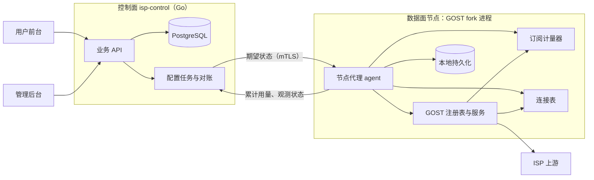

# 计量与执行方案

日期：2026-11-07。对应 [需求文档 0.3](01-需求文档.md)。状态：技术方案草案，待原型验证；本轮不写代码。

本文回答需求第 8 节的问题：如何按订阅精确计量、先授权后转发、在规定时延内关闭全部连接、执行到期，以及崩溃和并发时如何不重复、不多扣。前端见 [03](03-前端技术选型.md)。

## 1. 目标与约束

| 编号 | 必须证明的能力 | 需求来源 | 暂定指标（D-17） |
| --- | --- | --- | --- |
| E-1 | 认证成功后才计量，按订阅合并三种协议 | R-07 | 认证失败的字节计为 0 |
| E-2 | 先授权后转发，额度不可被并发超用 | R-08.2/3 | 透支 ≤ 1,000,000 字节 |
| E-3 | 耗尽、到期、暂停、撤销接入时关闭全部存量连接，包括空闲连接 | R-04.4、R-08.4、R-10 | ≤ 1 秒 |
| E-4 | 到期在数据面执行，不依赖控制面在线 | R-14.7 | 同 E-3 |
| E-5 | 崩溃只少计不多扣；重复上报幂等 | R-07.3、R-08.7 | 少计 ≤ 1 秒的用量 |
| E-6 | 换接入、换出口、组合更换不中断权益，并且不产生两条同时扣量的通道 | R-04、R-11 | 切换期间不出现双活 |

首期单节点、每个订阅只有一个权威活动实例（D-06），因此额度计数在节点进程内完成，**不需要跨进程预留或租约协议**。多节点留到 P1 另行设计。

## 2. GOST x v0.28.1 现状核对

源码位置为 `$GOMODCACHE/github.com/go-gost/x@v0.28.1`。

| 能力 | 现有实现 | 是否满足 | 说明 |
| --- | --- | --- | --- |
| 累计配额 | `limiter/quota` | 否 | 监听器层计量，包含认证失败和握手前的字节；写完才 `AddIn/AddOut`；阻断时 `Accept` 挂起而非拒绝；只在下一次读写时检查，空闲连接不关；`ExpiresAt` 之后不限制；窗口变化清零已用量；每 10 秒持久化一次；`Update(Used)` 会覆盖已用量 |
| 认证后的按客户端授权 | `limiter/traffic/wrapper` 配合 `core/limiter/traffic.Limiter.Wait(ctx, n) int` | 候选 | HTTP（`handler/http/connect.go:189`，调用点 `handler.go:534`）和 SOCKS5 CONNECT（`handler/socks/v5/connect.go:36`）在认证成功后包装连接；`Wait` 返回实际授权字节数，可以小于请求值 |
| 授权为 0 时的行为 | 同上 | 待验证 | 写方向：`Wait` 返回 0 时直接返回短写，`io.Copy` 会以 `ErrShortWrite` 结束。读方向：会先从连接读入，未授权部分进缓冲，再返回 0 字节、无错误，可能造成空转。另外 `Limit() <= 0` 时包装器会绕过限制，`Wait` 的上下文是 `context.Background()`，不可取消 |
| 关闭存量连接 | `service.Close()` | 否 | 只关闭处理器、观测器和监听器，已建立的连接继续存在 |
| 按服务统计 | `observer/stats` | 仅观测 | 周期上报，可用于监控，不能作为扣量依据 |
| 并发与带宽限制 | `limiter/conn`、`limiter/traffic` | 是 | 可直接用于套餐的并发连接上限和带宽上限 |

结论：**不用 `limiter/quota`**。改为在本仓实现自定义 `TrafficLimiter`、监听器包装和认证器，通过注册表接入 GOST；只有原型发现必须修改 `x`（第 8 节门槛）时，才 fork `x`。

## 3. 总体架构



- **控制面** `isp-control`：业务 API、账号、订单、账本、库存、任务、审计。使用 Go（D-16）和 PostgreSQL（D-23 建议）。可与节点同机部署。
- **节点代理** agent：编译进本仓的 GOST 二进制，与内核同进程。负责接收期望状态、管理 GOST 服务和链、计量、执行停用、持久化、上报。
- 控制面与 agent 之间走 mTLS 内部接口。GOST 原生管理 API 只在环回地址开放，或干脆不开放。

选择同进程，是因为计量器和连接表必须挂在 GOST 的热路径上；独立进程无法拿到连接对象。

## 4. 三层模型到 GOST 配置的映射

| 业务对象 | GOST 对象 | 命名 |
| --- | --- | --- |
| 订阅 | 计量器条目（自定义 `TrafficLimiter` 中的一个 key） | `sub-<subscription_id>` |
| 接入版本 | 3 个 service：`http`（tcp 监听）、`http`（tls 监听）、`socks5`（tcp 监听）；每个 service 绑定单用户认证器 | `acc-<subscription_id>-v<n>-{http,https,socks5}` |
| 出口绑定版本 | 1 个 chain，内含 1 个 hop，hop 中 1 个上游节点 | `exit-<subscription_id>-v<m>` |

service 的 `handler.limiter` 指向计量器，`handler.chain` 指向当前出口 chain，监听器使用带连接表的包装类型（第 6 节）。

### 4.1 换接入

1. 分配新端口组（跳过冷却中的端口），生成新凭据。
2. 创建新的 3 个 service，绑定同一个 `sub-<id>` 和当前出口 chain；经本地回环验证三种协议可用。
3. 控制面原子切换“生效接入版本”。
4. agent 删除旧 service，并通过连接表关闭旧接入上的全部连接，端口登记冷却开始时间。

两个版本共用同一个计量 key，切换期间不会出现两份余额。第 2 步与第 4 步之间旧接入仍可用，这段窗口应在秒级内结束；需求不要求宽限期，所以第 4 步紧接着执行。

“重置密码”只替换认证器的凭据，然后关闭该订阅的全部存量连接。

### 4.2 换出口

1. 用候选上游创建新 chain `exit-<id>-v<m+1>`，从节点经该 chain 访问 IP 回显端点，比较出口（R-11.3）。
2. 更新该订阅 3 个 service 的 chain 引用。
3. 关闭该订阅的全部存量连接（它们都经旧出口建立），新连接走新出口。
4. 删除旧 chain，原上游资源进入冷却或隔离。

### 4.3 组合更换

把 4.1 和 4.2 合成一个任务：新的 3 个 service 直接绑定新 chain，验证通过后切换生效版本，再删除旧 service 和旧 chain，并关闭全部旧连接。任一步失败时，删除新建对象，保持原状态。

## 5. 计量与授权

### 5.1 计量器状态（每订阅，在 agent 内存中）

```text
entitled_total  uint64   控制面下发：账本条目求和，带版本号，只接受更新的版本
used_total      uint64   原子递增；只增不减
expires_at      int64    控制面下发，UTC 纳秒
enabled         bool     由管理意图、账号、生命周期、数据面状态汇总后下发
persist_ok      bool     本地持久化是否健康
```

可用条件 `usable = enabled && persist_ok && now < expires_at && used_total < entitled_total`。

### 5.2 Wait 的语义

```text
Wait(ctx, n):
  if !usable: 触发该订阅的“断开全部连接”，return 0
  loop:
    u := used_total
    grant := min(n, entitled_total - u)
    if CAS(used_total, u, u+grant): break
  if used_total == entitled_total: 触发“耗尽”事件（异步断开全部连接）
  return grant
```

- 授权时就计入 `used_total`，所以并发连接不可能超过 `entitled_total`，透支为 0，满足 E-2。
- 代价：授权后底层写失败，这部分字节已计入但未送达。每次失败最多一个缓冲区（GOST 默认 32 KiB 左右）。这是对 R-07.4“成功转发才计”的有界偏差。若主人要求严格，就需要 fork 包装器，在短写时退还未写字节（第 8 节门槛 G-3）。
- `Limit()` 必须恒返回正数，否则包装器会绕过授权。
- `Wait` 本身不睡眠。套餐的带宽上限用另一个令牌桶实现，并且必须带超时，避免 `context.Background()` 不可取消导致连接关闭后仍被阻塞。

### 5.3 认证与明确拒绝

自定义认证器在校验凭据的同时检查 `usable`：不可用时直接认证失败，让新连接得到明确拒绝（HTTP 407、SOCKS5 认证失败），而不是像 `limiter/quota` 那样把 Accept 挂起。代价是客户端看到的是“认证失败”，分不清是密码错误还是流量耗尽；前台需要展示原因，以便客户自查。

认证失败的连接不会进入流量授权包装器，因此不计量，满足 E-1。

## 6. 连接表与主动断开

自定义监听器类型包装 GOST 的 `tcp` 和 `tls` 监听器，在 Accept 时把连接登记到 `service name → conns`，关闭时注销。agent 维护 `订阅 → 当前所有 service` 的映射。

触发“断开订阅全部连接”的事件：耗尽、到期计时器、暂停/封禁、换接入、重置密码、换出口、删除。处理方式是遍历连接表直接 `Close()` 底层连接，正在 Read 的 goroutine 立即返回错误。这也顺带解决了 5.2 读方向授权为 0 时可能的空转问题。

到期计时器：agent 为每个订阅按 `expires_at` 设置定时器，到点触发断开；同时 `Wait` 和认证器每次都检查时间，作为双保险。时钟依赖 NTP，偏差超过 1 秒时告警（R-14.7）。

## 7. 持久化、上报与对账

### 7.1 节点本地

- agent 每 ≤ 1 秒把各订阅的 `used_total` 写入本地持久化（bbolt 或追加日志，fsync）。连续写入失败时置 `persist_ok = false`，停止授权并告警（R-08.6）。
- 重启时 `used_total = max(本地值, 控制面最后确认值)`，再接受控制面下发的期望状态。

### 7.2 上报与控制面

- agent 每 ≤ 5 秒上报各订阅的累计 `used_total`（不是增量）。控制面执行 `used_total = GREATEST(used_total, $reported)`。上报重复、乱序、重放都是幂等的，不需要按批次去重。
- 控制面下发 `entitled_total`、`expires_at`、`enabled` 时带单调版本号；agent 只接受更高版本。
- 控制面宕机时，agent 按最后已知的 `entitled_total` 和 `expires_at` 继续执行。两者都是有限值，所以不存在无限离线消费。

### 7.3 账本与幂等

- `ledger_entries` 以 `(source_type, source_id, entitlement_kind)` 建唯一约束。订单确认、赠送、补偿、划转各有业务来源键，重复确认只会插入一次。
- 订阅的 `entitled_bytes_total` 和 `expires_at` 在同一事务中，由账本条目推导更新。
- 每个订阅同一时刻只允许一个进行中的变更任务（部分唯一索引）。订阅行带乐观锁版本号。
- 配置采用声明式对账：控制面保存期望状态，agent 回报观测版本；重试只是重新对账，不会重复产生业务副作用。

### 7.4 主要表（草案）

`users`、`sessions`、`email_tokens`、`subscriptions`、`access_versions`、`exit_bindings`、`upstream_resources`、`ports`（含冷却时间）、`plans`/`plan_versions`、`orders`、`payments`、`ledger_entries`、`usage_reports`（最近上报，用于对账）、`tasks`、`exit_requests`、`alerts`、`audit_logs`、`nodes`。具体 schema 在后端设计时冻结。

## 8. 原型验证计划与决策门槛

原型使用本地 GOST 实例模拟 ISP 上游，加本地 IP 回显端点，不接入付费上游。每项都要先写出会失败的断言。

| 编号 | 场景 | 通过标准 | 对应验收 |
| --- | --- | --- | --- |
| S-1 | 额度 1 MB，三种协议并发下载 100 MB | `used_total ≤ entitled_total`；客户端实收字节与 `used_total` 之差 ≤ 失败连接数 × 32 KiB | A-04、A-05、A-06 |
| S-2 | 一个空闲 CONNECT 隧道，另一连接耗尽额度 | 空闲隧道 ≤ 1 秒被关闭 | A-07 |
| S-3 | `expires_at` 设为 2 秒后，持续传输 | 到期后 ≤ 1 秒全部关闭，新连接被拒 | A-29、A-35 |
| S-4 | 用错误密码和垃圾数据冲击端口 | `used_total` 不变 | A-18 |
| S-5 | 换接入 | 旧凭据被拒，旧连接关闭，新接入可用，`used_total` 连续 | A-40、A-41 |
| S-6 | 换出口和组合更换 | 存量连接关闭，观察到新出口，无双活 | A-11、A-42 |
| S-7 | 负载中 `kill -9` 后重启 | `used_total` ≥ 最后持久值，少计 ≤ 1 秒用量 | A-10 |
| S-8 | 停掉控制面后持续使用 | 按最后已知额度和期限继续执行停用 | A-20 |
| S-9 | 普通 HTTP 转发（非 CONNECT），包括 keep-alive | 字节进入授权路径 | A-02、A-03 |
| S-10 | 授权为 0 时的读方向 | 无 CPU 空转（连接被连接表关闭） | A-05 |

决策门槛：

- **G-1**：S-9 不通过（普通 HTTP 转发绕过 `setupTrafficLimiter`），需要 fork `x` 修改 HTTP 处理器，或首期只开放 CONNECT。
- **G-2**：S-10 无法靠连接表消除空转，需要 fork `x` 修改读包装器。
- **G-3**：主人要求严格“成功写出才计”，需要 fork 包装器，实现短写退还。
- **G-4**：S-1 至 S-3 不达标，不允许收费，调整实现，不下调指标。

任一门槛触发，都在 `UPSTREAM.toml` 登记 `x` 的 fork 起点，并评估跟进上游的成本。

## 9. 仓库布局建议

```text
cmd/gost/            现有 CLI；register.go 增加 agent 组件的空白导入
cmd/isp-control/     控制面入口（新增）
internal/agent/      节点代理：期望状态、计量器、连接表、认证器、持久化
internal/control/    控制面：API、账本、订单、任务、对账
web/                 前端双端（见 03）
tests/e2e/           现有 E2E；原型专项另放 internal/*/ 的进程内测试
```

与 GOST 上游代码保持分目录，减少合并冲突。新增代码之后需要同步更新 `CLAUDE.md` 的结构说明。

## 10. 开放问题

1. HTTPS 入口的证书：使用通配证书还是单域名证书，自动续期由谁负责（D-06）。
2. 端口范围与防火墙：每个接入版本占 3 个端口，加上冷却期，按 D-06 的规模估算端口池。
3. 耗尽时认证失败的提示语义：是否需要单独的 HTTP 403 响应体来提示“流量已用完”（需改处理器，属于 G 类门槛）。
4. 出口检测端点：自建还是使用第三方，检测流量的预算。
