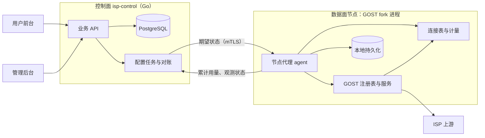

# 计量与执行方案

日期：2026-11-07。对应 [需求文档 0.3](01-需求文档.md)。状态：计量原型已在本机回环环境通过（第 8 节），尚未接入控制面、真实 ISP 或多机部署。

本文回答需求第 8 节的问题：如何按订阅精确计量、先授权后转发、在规定时延内关闭全部连接、执行到期，以及崩溃和并发时如何不重复、不多扣。前端见 [03](03-前端技术选型.md)。原型代码在 `internal/agent/`。

## 1. 目标与约束

| 编号 | 必须证明的能力 | 需求来源 | 暂定指标（D-17） |
| --- | --- | --- | --- |
| E-1 | 认证失败的连接不计量；认证成功的连接按订阅合并三种协议 | R-07 | 认证失败的字节计为 0 |
| E-2 | 先授权后转发，额度不可被并发超用 | R-08.2/3 | 透支 ≤ 1,000,000 字节 |
| E-3 | 耗尽、到期、暂停、撤销接入时关闭全部存量连接，包括空闲连接 | R-04.4、R-08.4、R-10 | ≤ 1 秒 |
| E-4 | 到期在数据面执行，不依赖控制面在线 | R-14.7 | 同 E-3 |
| E-5 | 崩溃只少计不多扣；重复上报幂等 | R-07.3、R-08.7 | 少计 ≤ 1 个持久化间隔的用量 |
| E-6 | 换接入、换出口、组合更换不中断权益，并且不产生两条同时扣量的通道 | R-04、R-11 | 切换期间不出现双活 |
| E-7 | 上游失败时显式失败，不从中转直连目标 | R-01.3 | 目标侧观察不到直连 |

首期单节点、每个订阅只有一个权威活动实例（D-06），因此额度计数在节点进程内完成，**不需要跨进程预留或租约协议**。多节点留到 P1 另行设计。

## 2. GOST x v0.28.1 现状核对

源码位置为 `$GOMODCACHE/github.com/go-gost/x@v0.28.1`。“原型结论”一列来自第 8 节的测试。

| 能力 | 现有实现 | 原型结论 | 说明 |
| --- | --- | --- | --- |
| 累计配额 | `limiter/quota` | 不采用 | 监听器层计量，包含认证失败的字节；写完才累加；阻断时 `Accept` 挂起而非拒绝；只在下次读写时检查，空闲连接不关；`ExpiresAt` 之后不限制；窗口变化清零已用量；每 10 秒持久化；`Update(Used)` 会覆盖已用量 |
| 认证后的按客户端限速 | `limiter/traffic/wrapper` + `Limiter.Wait(ctx, n)` | **不适合计量** | ① 普通 HTTP 转发的首个请求正文经处理器内的 `bufio.Reader`（`handler/http/handler.go:399`）直接读底层连接，完全绕过包装器：上传 2 MB 只计了 142 字节；② 上行授权不足时，读包装器进入只读内部缓冲、不再触碰连接的分支，返回 0 字节且无错误，形成无法通过关连接终止的空转。该接缝仍可用于带宽限速 |
| 连接上下文 | `service.go:300`：连接实现 `Context()` 时，用它作为请求上下文 | 采用 | HTTP 处理器把它传给认证器，认证器据此找回本连接 |
| SOCKS5 认证上下文 | `handler/socks/v5/selector.go:91` | 采用（变通） | 用 `context.Background()` 调认证器，只附带源地址；改为按“服务名 + 源地址”在连接表中查找 |
| 关闭存量连接 | `service.Close()` | 否 | 只关闭处理器、观测器和监听器，已建立的连接继续存在 |
| 链缺失或选不出节点 | `chain/router.go:156`、`chain/route.go:155` | **危险** | 链不存在时路由为 nil，或路由里没有节点时，都会改用 `DefaultRoute` **从中转服务器直连目标**（`TestCharacterizeGOSTDirectFallback` 已复现）。必须包装为失败即拒绝 |
| 出口链动态查找 | `registry/chain.go` 的 `chainWrapper` | 采用 | 服务按名字在每次路由时查找链，换出口只需原子替换链内容 |
| 按服务统计 | `observer/stats` | 仅观测 | 周期上报，可用于监控，不能作为扣量依据 |
| 并发与带宽限制 | `limiter/conn`、`limiter/traffic` | 可用 | 用于套餐的并发连接上限和带宽上限，原型未接入 |

结论：**全部通过本仓注册的组件接入 GOST，不需要 fork `x`**。注册的组件为：带连接表的监听器 `isp-tcp`、`isp-tls`，以及认证器 `isp-auth`；另外用失败即拒绝的链包装器替代直接注册的链。

## 3. 总体架构



- **控制面** `isp-control`：业务 API、账号、订单、账本、库存、任务、审计。使用 Go（D-16）和 PostgreSQL（D-23 建议）。可与节点同机部署。
- **节点代理** agent：编译进本仓的 GOST 二进制，与内核同进程。负责接收期望状态、管理 GOST 服务和链、计量、执行停用、持久化、上报。
- 控制面与 agent 之间走 mTLS 内部接口。GOST 原生管理 API 只在环回地址开放，或干脆不开放。

选择同进程，是因为计量和连接表必须挂在 GOST 的连接上；独立进程拿不到连接对象。

## 4. 三层模型到 GOST 配置的映射

| 业务对象 | GOST 对象 | 命名 |
| --- | --- | --- |
| 订阅 | agent 内的计量状态，被该订阅所有服务的连接共享 | `subscription_id` |
| 接入版本 | 3 个 service：`http`（`isp-tcp`）、`http`（`isp-tls`）、`socks5`（`isp-tcp`）；共用认证器 `isp-auth` | `acc-<subscription_id>-v<n>-{http,https,socks5}` |
| 出口绑定 | 每个接入版本一个失败即拒绝的链包装器，内含当前上游 | `exit-<subscription_id>-a<n>` |

每个 service 只属于一个订阅，所以连接在 Accept 时就能确定所属订阅；认证器还会校验“凭据属于该服务所在的接入版本”，一个订阅的凭据不能用在另一个订阅的端口上。

### 4.1 换接入

1. 分配新端口组（跳过冷却中的端口），生成新凭据。
2. 注册新链包装器（内容为当前出口），创建新的 3 个 service。任一失败就回收已创建的对象，订阅保持原状。
3. 在同一把锁内删除旧用户名、登记新用户名和新服务，此后旧凭据立即被拒。
4. 关闭旧 service 的监听，并通过连接表关闭旧接入上的全部连接，然后注销旧链。

“重置密码”只替换凭据中的密码，然后关闭该订阅的全部存量连接。

### 4.2 换出口

1. 用候选上游构造新链，从节点经新链访问 IP 回显端点，比较出口（R-11.3；原型未实现比较步骤）。
2. 原子替换当前接入链包装器的内容。由于服务按名字动态查找链，不存在“链暂时缺失”的窗口，也就不会触发直连。
3. 关闭该订阅的全部存量连接，新连接走新出口。

### 4.3 组合更换

调用换接入时直接带上新出口：新的 3 个 service 绑定新的链包装器，就绪后切换，再撤销旧接入。旧接入始终只走旧出口，新接入始终只走新出口，没有中间态。任一步失败时整体回滚（原型以端口占用注入失败验证）。

## 5. 计量与授权

### 5.1 计量位置

计量放在连接表包装的客户端连接上：

- HTTPS 入口包装的是 TLS 解密后的连接，因此计的是应用层字节，不含 TLS 封装。
- 认证前的读写字节暂存在连接上。认证成功时一次性计入订阅；认证失败的连接从不计入。
- 认证器在 HTTP 路径上通过连接的 `Context()` 找回本连接，在 SOCKS5 路径上按服务名和源地址查找。**两种方式都找不到时拒绝认证**，不存在“认证通过但不计量”的连接。

口径因此调整为：**认证成功的连接上的全部应用层字节，含代理协商字节**（D-03）。握手字节通常不足 1 KB。这样定义的另一个原因是，处理器在认证前用 4 KB 缓冲预读的请求正文也会被计入，杜绝“每个连接只发一个小请求”的免费上传。

### 5.2 订阅状态（agent 内存中）

```text
entitled_total  uint64   控制面下发：账本条目求和，带版本号，只接受更高版本
used_total      uint64   原子递增，只增不减
expires_at      int64    控制面下发，UTC 纳秒
enabled         bool     由管理意图、账号、生命周期、数据面状态汇总后下发
persist_ok      bool     本地持久化是否健康（节点级）
```

可用条件 `usable = persist_ok && enabled && now < expires_at && used_total < entitled_total`。

### 5.3 读写授权

- **下行（写给客户端）严格预授权**：用 CAS 一次授权 `min(n, 剩余额度)` 并立即计入 `used_total`，并发连接的授权总和不可能超过额度。授权为 0 时返回错误，并关闭该订阅全部连接。
- **上行（从客户端读）**：只有读到之后才知道字节数，所以单次读取限制为 16 KiB，读后计入。若读后达到额度，或读前已不可用，就关闭该订阅全部连接，下一次读取立即失败。上行透支上限为“存量连接数 × 16 KiB”；按套餐的并发连接上限（如 50）计算，不超过 D-17 的 1 MB。
- 原型实测：1 MB 额度、三种协议 12 个并发下载，最终透支 67 字节。

已知的有界偏差：下行授权后底层写失败，这部分字节已计入但未送达，每次失败最多一个写块。只有主人要求严格“成功写出才计”时才需要处理（G-3）。

### 5.4 明确拒绝

认证器在校验凭据的同时检查 `usable`，不可用时直接认证失败：新连接得到明确的拒绝（HTTP 407、SOCKS5 认证失败），而不是被挂起。代价是客户端分不清“密码错误”还是“流量耗尽”，前台需要展示原因，以便客户自查。

## 6. 连接表、主动断开与出口保护

`isp-tcp`、`isp-tls` 两种监听器包装 GOST 原有的 `tcp`、`tls` 监听器，在 Accept 时把连接登记到 `服务名 → 连接集合`，连接关闭时注销。

触发“断开订阅全部连接”的事件：耗尽、到期计时器、暂停/封禁、换接入、重置密码、换出口、持久化失败。处理方式是遍历连接表直接关闭底层连接，正在读写的 goroutine 立即返回错误。

到期：agent 为每个订阅按 `expires_at` 设置定时器，到点触发断开；同时认证和每次读写都检查时间，作为双保险。时钟依赖 NTP，偏差超过 1 秒时告警（R-14.7）。

出口保护：链包装器在内部链缺失、返回 nil 路由或路由没有节点时，返回一个必然失败的路由，阻止 GOST 退化为直连。

## 7. 持久化、上报与对账

### 7.1 节点本地

- agent 每 ≤ 1 秒把各订阅的 `used_total` 原子写入本地文件（临时文件、fsync、rename）。写入失败时置 `persist_ok = false`，断开全部连接并停止授权（R-08.6），恢复后自动放行。
- 重启时 `used_total = max(本地值, 控制面下发的 UsedFloor)`。

### 7.2 上报与控制面

- agent 每 ≤ 5 秒上报各订阅的累计 `used_total`，不是增量。控制面执行 `used_total = GREATEST(used_total, $reported)`，重复、乱序、重放天然幂等，不需要按批次去重。
- 控制面下发 `entitled_total`、`expires_at`、`enabled` 时带单调版本号，agent 只接受更高版本。
- 控制面宕机时，agent 按最后已知的额度和期限继续执行。两者都是有限值，所以不存在无限离线消费。

### 7.3 账本与幂等

- `ledger_entries` 以 `(source_type, source_id, entitlement_kind)` 建唯一约束。订单确认、赠送、补偿、划转各有业务来源键，重复确认只插入一次。
- 订阅的 `entitled_bytes_total` 和 `expires_at` 在同一事务中，由账本条目推导更新。
- 每个订阅同一时刻只允许一个进行中的变更任务（部分唯一索引）。订阅行带乐观锁版本号。
- 配置采用声明式对账：控制面保存期望状态，agent 回报观测版本；重试只是重新对账，不会重复产生业务副作用。

### 7.4 主要表（草案）

`users`、`sessions`、`email_tokens`、`subscriptions`、`access_versions`、`exit_bindings`、`upstream_resources`、`ports`（含冷却时间）、`plans`/`plan_versions`、`orders`、`payments`、`ledger_entries`、`usage_reports`、`tasks`、`exit_requests`、`alerts`、`audit_logs`、`nodes`。具体 schema 在后端设计时冻结。

## 8. 原型验证结果

环境：本机回环；伪 ISP 上游是测试内的最小 HTTP CONNECT 代理，忽略请求的目标地址，连到各自带标签的目标端点（`/ip` 返回 `exit-A` 或 `exit-B`，用来模拟“目标侧看到的出口”）；客户端请求的目标地址指向一个标签为 `DIRECT` 的金丝雀端点，只要发生直连就会被观察到。

运行方式：`go test ./internal/agent/`。2026-11-07 的结果：开启 `-race` 重复 5 次、普通模式重复 10 次，全部通过。

| 编号 | 场景 | 测试 | 结果 |
| --- | --- | --- | --- |
| S-1 | 1 MB 额度，三种协议 12 个并发下载 20 MB | `TestConcurrentProtocolsCannotExceedQuota`、`TestDownstreamGrantIsExact` | 通过，透支 67 字节；下行授权在 64 路并发下精确等于额度 |
| S-2 | 空闲隧道，另一连接耗尽额度 | `TestIdleTunnelClosedOnExhaustion` | 通过，三种协议的空闲隧道均 ≤ 1 秒关闭 |
| S-3 | 1.5 秒后到期，空闲隧道与持续下载并存 | `TestExpiryClosesAllConnections` | 通过：≤ 1 秒内连接清零，此后用量不再增长，新连接被拒 |
| S-4 | 错误密码与 1 MB 垃圾数据冲击三个端口 | `TestUnauthenticatedBytesNotMetered` | 通过，用量为 0 |
| S-5 | 更换接入、重置密码、跨订阅凭据 | `TestRotateAccess`、`TestResetPassword`、`TestCredentialsBoundToOwnPorts` | 通过 |
| S-6 | 换出口、组合更换（含注入失败回滚） | `TestSwapExit`、`TestCombinedSwap` | 通过 |
| S-7 | 不做最终落盘就重建 agent | `TestCrashRecoveryLosesAtMostOneFlush` | 通过；恢复值 ≥ 最后持久值，丢失量为最后一个持久化间隔内的流量 |
| S-8 | 控制面离线 | 结构保证 | agent 不依赖控制面执行；S-1 和 S-3 都没有控制面参与 |
| S-9 | 普通 HTTP 转发的下载、大正文上传、20 个连接各发 3 KB 正文 | `TestPlainHTTPForwardMetered` | 首版方案失败（2 MB 上传只计 142 字节），改用 5.1 方案后通过 |
| S-10 | 耗尽后的上行 | `TestExhaustedUploadDoesNotSpin` | 通过，goroutine 回到基线，连接表清零 |
| — | 上游宕机反复请求 | `TestUpstreamDownNeverFallsBackToDirect`、`TestExitChainFailsClosed` | 通过，金丝雀 0 次命中 |
| — | 未包装时 GOST 是否直连 | `TestCharacterizeGOSTDirectFallback` | 复现直连，证实第 2 节结论 |
| — | 认证器挂在未跟踪的监听器上 | `TestAuthRequiresTrackedConn` | 通过，拒绝认证 |
| — | 持久化失败、暂停优先于充值 | `TestPersistFailureStopsForwarding`、`TestPauseOverridesTopUp` | 通过 |

测试可证伪性：对 8 处关键防线做了源码变异。其中 6 处被对应测试杀掉：到期计时器、链包装器、下行 CAS 上限、握手字节计入、认证必须找到连接、SOCKS5 源地址查找。另外 2 处变异存活，属于预期内的多重防线：删除旧用户名后，旧凭据仍因服务绑定被拒；去掉读前可用性检查后，暂停仍会先断开连接。

决策门槛：

| 门槛 | 结论 |
| --- | --- |
| G-1 普通 HTTP 转发绕过计量 | 触发，已通过 5.1 方案在本仓内解决，不 fork `x` |
| G-2 读方向空转 | 不再适用：不使用处理器限速接缝做计量 |
| G-3 严格“成功写出才计” | 未触发；有界偏差见 5.3，待主人确认是否接受 |
| G-4 S-1～S-3 不达标 | 未触发 |

原型的局限（进入实现前需补齐）：

1. 崩溃是在进程内模拟的，没有真实的 `kill -9` 或断电测试；fsync 后的数据持久性依赖文件系统。
2. 只在单机回环上验证，没有测吞吐、延迟和 CPU 开销；每次读写多一次原子操作和一次可用性检查，需在压测中确认。
3. 未实现：出口 IP 比较、端口冷却与换接入频率、每订阅并发连接与带宽上限、出站 25 端口和私网封禁、控制面接口与上报、时钟偏差告警。
4. `connBySrc` 线性扫描该服务的连接，单订阅连接数大时需要按源地址建索引。
5. GOST 升级时需重新核对第 2 节依赖的行为（`Context()` 传递、SOCKS5 认证上下文、直连回退），这些都不是 GOST 的公开契约，变化后测试会失败。

## 9. 仓库布局

```text
cmd/gost/            现有 CLI；接入 agent 时在 register.go 增加组件注册
cmd/isp-control/     控制面入口（待建）
internal/agent/      节点代理原型：计量、连接表、认证器、出口包装、持久化及其测试
internal/control/    控制面：API、账本、订单、任务、对账（待建）
web/                 前端双端（见 03，待建）
tests/e2e/           现有 E2E
```

与 GOST 上游代码保持分目录，减少合并冲突。

## 10. 开放问题

1. HTTPS 入口的证书：使用通配证书还是单域名证书，自动续期由谁负责（D-06）。
2. 端口范围与防火墙：每个接入版本占 3 个端口，加上冷却期，按 D-06 的规模估算端口池。
3. 耗尽时认证失败的提示语义：是否需要单独的 HTTP 403 响应体来提示“流量已用完”。这需要改处理器，属于 fork 范围。
4. 出口检测端点：自建还是使用第三方，检测流量的预算。
5. G-3：是否接受“写失败时最多多计一个写块”的偏差。
