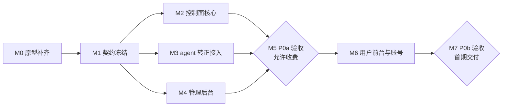

# 施工文档

日期：2026-11-07。对应 [需求文档 0.3](01-需求文档.md)、[验收清单](02-需求核对与验收清单.md)、[前端技术选型](03-前端技术选型.md)、[计量与执行方案](04-计量与执行方案.md)。状态：首版，供实施排期与分工使用。

本文只回答“按什么顺序、拆成哪些工作包、每包交付什么、怎样算完成”。业务规则以 01 为准（尤其 R-18 权益规则与 §7 状态），执行层设计以 04 为准，本文不重复定义；冲突时以 01、04 为准并回改本文。

## 1. 当前基线

| 部分 | 现状 | 位置 |
| --- | --- | --- |
| 转发内核 | GOST v3.3.3 fork，未改转发行为 | `cmd/gost/`、`go.mod` |
| 节点 agent | 原型：按订阅计量、连接表断开、失败即拒绝的出口链、换接入/换出口/组合更换、到期计时器、本地持久化；本机回环测试 S-1～S-10 全过，未接入 `cmd/gost` | `internal/agent/`，结果见 04 §8 |
| 三份契约（M1 已冻结） | 数据库 schema 与内嵌迁移器、一次性 PostgreSQL 测试助手；对外 OpenAPI 3.1（用户端 23 个、管理端 75 个操作）与生成的前端类型；控制面 ↔ agent 协议（消息、mTLS、长轮询、开发证书） | `migrations/`、`internal/control/store`、`api/openapi.yaml`、`internal/control/apispec`、`web/packages/api-client/src/generated/`、`internal/agentproto/`；补充决定见 06 §8 |
| 控制面业务 | 未开始（M2） | — |
| 用户前台 | 可交互原型：真实技术栈、内存模拟数据；覆盖登录/注册/验证/找回、我的 IP、IP 详情（换接入、申请换出口、改名、记录）、购买、续时长/买流量、订单与付款说明、申请、账号 | `web/apps/portal`、`web/packages/api-client` |
| 视觉与设计系统 | 用户前台方向“SIM 卡与套餐余量”已定；两端共用部件抽到 `@isp/ui`；管理后台补充侧栏、通用表格、确认框、换出口步骤、用量趋势 | `DESIGN.md`、`.impeccable/`、`web/packages/ui` |
| 管理后台 | 可交互原型：真实技术栈、内存模拟数据（`createMockAdminApi` 按服务端规则校验）；R-12 全部页面：登录（密码 + TOTP、首次绑定、恢复码）、运营概览（待核款置顶）、订阅列表与详情（余量、出口、接入、账本 / 接入版本 / 出口版本 / 任务 / 事件 / 订单，暂停恢复、换接入、账本入账、划转、删除、重试开通）、换出口五步流程、上游库存、套餐与流量包版本、规则版本、用户（封禁 / 解封）、订单（人工核款、取消、退款复核）、换出口申请、节点与监控（A-37 趋势图）、告警、审计；尚未接真实 API（`VITE_ADMIN_API=http` 切换） | `web/apps/admin`、`web/packages/api-client/src/admin`、`web/packages/ui` |
| 已冻结决策 | D-01～D-03、D-08～D-14、D-16、D-17（透支 ≤ 1,000,000 字节、停用 ≤ 1 秒，接受 G-3 写失败偏差）、D-22 | 01 §12.1 |

## 2. 目标结构

```text
cmd/gost/                  GOST 入口；新增 agent 启动参数与组件注册
cmd/isp-control/           控制面入口
internal/agent/            节点 agent（由原型转正）
internal/agentproto/       控制面 ↔ agent 的期望状态与上报消息（两端共用）
internal/control/
  api/                     对外 HTTP API（用户、管理员两组路由）与 OpenAPI 生成
  store/                   PostgreSQL 访问、迁移、事务封装
  ledger/                  账本条目与权益推导
  order/                   订单、收款确认、履约
  subscription/            订阅生命周期、到期/保留/释放调度
  task/                    换接入、换出口、组合更换任务与对账
  inventory/               上游资源、端口池与冷却、库存预留
  account/                 邮箱账号、会话、验证与找回、限流
  admin/                   管理员、TOTP、审计
  probe/                   出口检测调度
  alert/                   告警事件
api/openapi.yaml           对外契约（由后端产出，前端生成类型）
migrations/                数据库迁移（只前进，不删库重建）
web/apps/portal/           用户前台
web/apps/admin/            管理后台
web/packages/api-client/   生成的类型与请求层；mock 保留为测试夹具
deploy/                    单节点部署：systemd 单元、反向代理示例、备份脚本（不含任何真实密钥）
```

部署形态（首期单节点，D-06 待定规模）：同一台机器上运行 `gost`（内含 agent）、`isp-control`、PostgreSQL，以及托管两端静态文件和 API 的反向代理。agent 与控制面之间走 mTLS；GOST 原生管理 API 不对外开放。

## 3. 阶段与里程碑



| 里程碑 | 进入条件 | 完成标准 | 估算（人日） |
| --- | --- | --- | --- |
| M0 原型补齐 | 无 | 04 §8 的局限 1～4 补齐或给出结论：真实 `kill -9`、压测基线、并发/带宽上限、出站封禁、出口比较、源地址索引 | 后端 6～9 |
| M1 契约冻结 | M0 无阻断结论；D-23 确认数据库 | schema 与迁移、`api/openapi.yaml`、`agentproto` 三份契约评审通过并提交；D-18、D-19 给出首期取值 | 后端 5～7，前端 1 |
| M2 控制面核心 | M1 | P0a 后端能力全部有测试（§4.2）；真实数据库专项（事务、幂等、恢复）通过 | 后端 18～25 |
| M3 agent 转正 | M1 | `gost` 二进制可按控制面期望状态运行；上报、对账、证书加载可用；原型测试与新增测试全过 | 后端 8～12 |
| M4 管理后台 | M1（可先用 mock 并行） | R-12 页面可用，接真实 API | 前端 15～20 |
| M5 P0a 验收 | M2、M3、M4 | 02 中批次为 P0a 的场景全部通过；运行手册初版；备份恢复演练一次 | 双方 5～8 |
| M6 用户前台与账号 | M5（账号后端可提前） | 原型转正接真实 API；R-15～R-17 全部页面；邮件发送接入 | 前端 8～12，后端 6～9 |
| M7 P0b 验收 | M6 | 02 中批次为 P0b 的场景全部通过；手机验收（A-39） | 双方 4～6 |

估算按 1 名 Go 后端 + 1 名前端、熟悉本仓的前提给出，只用于排期参考；M1 冻结后按契约规模重估。合计约 80～110 人日。**M5 之前不得收费**（01 §2.2），**D-20 合规门槛完成之前不得对外销售**。

## 4. 工作包

每个工作包的完成标准都包含：代码合入、对应测试先失败后通过（01 §10）、相关文档同步。验收编号见 02。

### 4.1 数据面 agent（M0、M3）

| 编号 | 内容 | 产出 | 验收 |
| --- | --- | --- | --- |
| A-W1 | 真实进程崩溃：子进程跑 agent，负载中 `kill -9`，重启后核对 `used_total` 不回退、少计 ≤ 1 秒用量 | 测试与结论写入 04 §8 | A-10、A-22 |
| A-W2 | 压测基线：单订阅与多订阅吞吐、P99 延迟、CPU；对比不带计量的 GOST | 压测脚本与报告；如开销不可接受，回到 04 评估 | 01 §9 |
| A-W3 | 并发连接上限与带宽上限：接入 `limiter/conn`、`limiter/traffic`，按套餐下发 | 组件配置与测试 | A-46 |
| A-W4 | 出站封禁：在出口链包装器的路由入口检查目标地址，拒绝 25 端口、私网、链路本地与云元数据地址；默认拒绝，失败即拒绝 | 实现与特征测试（含 DNS 解析后再判断） | A-46 |
| A-W5 | 换出口前的出口比较：经候选链访问本地 IP 回显端点，校验国家、IP 变化、平台内独占 | 实现与测试；检测流量不计入客户 | A-11、A-12、A-15 |
| A-W6 | `connBySrc` 按“服务 + 源地址”建索引 | 实现与基准测试 | 04 §8 局限 4 |
| A-W7 | `agentproto`：期望状态（订阅额度/期限/启用、接入版本、出口绑定，均带单调版本）与上报（各订阅累计 `used_total`、观测版本、连接数、持久化状态） | 消息定义、mTLS 双向认证、重放与乱序测试 | A-20、A-22 |
| A-W8 | 接入 `cmd/gost`：新增 agent 启动配置（控制面地址、节点证书、数据目录）；`register.go` 注册 `isp-tcp`、`isp-tls`、`isp-auth`；不改变无 agent 时的原有行为 | 构建与回归（原有 E2E 不在未授权时运行） | A-01、A-02 |
| A-W9 | HTTPS 入口证书加载与热更新；时钟偏差检测与告警 | 实现与测试 | R-13、R-14.7 |

依赖提醒：原型依赖的 GOST 内部行为（04 §2：`Context()` 传递、SOCKS5 认证上下文、直连回退）不是公开契约。升级 `go-gost/x` 后必须先跑 `go test ./internal/agent/`。

### 4.2 控制面（M1、M2、M6）

| 编号 | 内容 | 要点 | 验收 |
| --- | --- | --- | --- |
| C-W1 | schema 与迁移 | 表见 04 §7.4；订单收款与履约两列分开；`plan_versions` 只增不改；`ports` 带冷却截止时间 | A-38 |
| C-W2 | 账本与权益推导 | `ledger_entries` 唯一键 `(source_type, source_id, entitlement_kind)`；订阅的额度与到期时间在同一事务内由账本推导；调整、赠送、退款、划转均为独立条目 | A-08、A-21、A-33、A-34、A-45 |
| C-W3 | 订单与人工核款 | 确认收款以订单号为业务键，幂等；含流量续费两项各自入账、部分失败可见；用户“已转账”反馈不改收款状态 | A-08、A-28、A-33 |
| C-W4 | 订阅生命周期 | 待履约 → 有效 → 保留期 → 已释放（01 R-18 状态图）；保留期满释放资源、余额保留；续时长重新履约 | A-29～A-32、A-44 |
| C-W5 | 变更任务与对账 | 换接入、重置密码、换出口、组合更换；每订阅同一时刻一个进行中任务（部分唯一索引）；声明式对账，重试不产生副作用；换接入频率按 D-18 | A-13、A-17、A-40～A-43 |
| C-W6 | 库存与端口池 | 资源状态（01 R-16.3）；平台内独占；未付款新购预留 24 小时；每用户最多 3 个未付款新购；端口冷却 | A-27、A-38 |
| C-W7 | 用量接收 | `used_total = GREATEST(used_total, reported)`；上报与下发都带版本 | A-03、A-10、A-22 |
| C-W8 | 管理员与审计 | 管理员强制 TOTP（D-15 建议）；会话与客户分开；敏感操作审计；不能查看密码或无痕冒用 | A-26 |
| C-W9 | 出口检测与告警 | 定时检测与手动检测；结果带时间，过期可辨；告警事件覆盖节点离线、上游异常、配置失败、证书、计量持久化失败、时钟偏差 | A-15、A-37、R-19 |
| C-W10 | 邮箱账号（M6，可提前） | 注册、验证、登录、找回、改密；验证材料有期限、用途绑定、尝试上限、一次性；公开接口不泄露邮箱是否注册；服务端限流；改密撤销会话 | A-23～A-25 |
| C-W11 | 换出口申请（M6） | 同一订阅未完成申请只保留一条；免费次数按 D-19；客户视图不含内部备注与供应商信息 | A-36 |
| C-W12 | 越权防护 | 所有资源按“当前用户拥有”过滤；ID 不可枚举；导出同样过滤 | A-16、A-26 |

### 4.3 前端（M4、M6）

| 编号 | 内容 | 要点 | 验收 |
| --- | --- | --- | --- |
| F-W1 | api-client 生成 | 从 `api/openapi.yaml` 生成类型与请求层，替换手写的 `src/index.ts`；保留 `createMockApi` 作为测试夹具，签名与生成类型对齐 | 类型检查通过 |
| F-W2 | 管理后台脚手架 | `web/apps/admin`，同一组 token（`DESIGN.md`）；独立子域名；封装带筛选、分页、列配置的表格组件 | — |
| F-W3 | 管理后台页面 | 运营概览、订阅、上游库存、套餐、用户、订单（人工核款）、换出口申请、节点与监控、审计（01 R-12）；换出口按“候选录入 → 验证 → 比较 → 提交 → 查结果”的流程 | P0a 各项的管理端部分 |
| F-W4 | 用户前台转正 | 见 §6 | A-23～A-25、A-36、A-39 |
| F-W5 | 趋势图 | ECharts 按需引入；标注来源、单位、数据时间；断联、空数据、零值、过期分开表达 | A-37 |

## 5. 接口契约（M1 已冻结）

三份契约于 2026-11-08 冻结，之后的改动必须同时改契约文件、对应测试与本文/01/04 中受影响的段落（§10）：

| 契约 | 文件 | 守护测试 |
| --- | --- | --- |
| 数据库 schema | `migrations/0001_init.sql`（表与不变量见 04 §7.4） | `go test ./internal/control/store/`（真实 PostgreSQL） |
| 对外业务 API | `api/openapi.yaml`（OpenAPI 3.1）；Go 侧 `apispec.Routes()` / `apispec.Paths()` 给出路由集合；前端 `pnpm --filter @isp/api-client gen` 生成 `src/generated/schema.ts` | `go test ./internal/control/apispec/`；`src/generated-compat.test.ts`（类型层） |
| 控制面 ↔ agent | `internal/agentproto`（docs/06 §5） | `go test ./internal/agentproto/` |

用户端 API 与原型 `PortalApi` 一一对应，operationId 即方法名；另加原型缺失的 `confirmPasswordReset`：

| 原型方法 | 路径 | 说明 |
| --- | --- | --- |
| `session` / `login` / `logout` | `GET /api/me`、`POST /api/sessions`、`DELETE /api/sessions/current` | 会话放 HttpOnly Cookie；未登录 `GET /api/me` 返回 401 |
| `register` / `verifyEmail` / `resendVerification` / `requestPasswordReset` / `changePassword` | `POST /api/account/register`、`/verify-email`、`/resend-verification`、`/password-reset`、`/change-password` | 不泄露邮箱是否注册：注册不建会话，`verify-email` 未登录时带 `email` 并在成功时登录 |
| （新增）`confirmPasswordReset` | `POST /api/account/password-reset/confirm` | 设新密码并撤销全部会话；管理员代建用户也用它首次设密码 |
| `listSubscriptions` / `getSubscription` / `renameSubscription` | `GET /api/subscriptions`、`GET`/`PATCH /api/subscriptions/{subscriptionId}` | `blockers` 已按 01 §7.2 排序；`remainingSeconds` 按服务端时钟 |
| `listSubscriptionEvents` | `GET /api/subscriptions/{subscriptionId}/events` | 合并权益账本与接入/出口版本历史 |
| `changeAccess` / `acknowledgeAccess` | `POST /api/subscriptions/{subscriptionId}/access-changes`（幂等键）、`POST .../access/ack` | 返回新接入；`unseenChanges` 由服务端保存；次数用完 429 `quota_exhausted` |
| `getCatalog` | `GET /api/catalog` | 访客可读；`Plan`/`TrafficPack` 带 `versionId` 供下单校验 |
| `createOrder` / `listOrders` / `getOrder` / `claimPaid` / `cancelOrder` | `POST`/`GET /api/orders`（幂等键）、`GET /api/orders/{orderId}`、`POST .../claim-paid`、`POST .../cancel` | 服务端校验库存、价格版本与未付款上限；`renew_time` 可带 `packId` 即含流量续费 |
| `listExitRequests` / `createExitRequest` | `GET`/`POST /api/exit-requests`（幂等键） | 冲突返回 409 与 `existing` 现有申请 |

管理端 `/admin-api/`（operationId 以 `admin` 开头）覆盖 01 R-12：

| 范围 | 路径 |
| --- | --- |
| 登录与 TOTP | `POST /sessions`（密码）→ `POST /sessions/current/mfa`（TOTP、恢复码；首次登录即绑定）、`DELETE /sessions/current`、`GET /me`、`POST /me/recovery-codes` |
| 概览 | `GET /overview` |
| 订阅 | `GET`/`POST /subscriptions`（列表筛选；代建并开通）、`GET`/`PATCH /subscriptions/{id}`、`.../pause`、`.../resume`、`.../deletion`、`.../fulfillment`、`.../access-changes`、`.../access/reveal`（审计）、`.../access-versions`、`.../exit-bindings`、`.../tasks`、`.../ledger`、`.../ledger-entries`（调整/赠送/补偿）、`.../events`、`.../usage`（趋势，带数据时间）；`POST /transfers`（同用户全额划转）；`GET /tasks/{taskId}`、`GET /probes/{probeId}` |
| 换出口流程 | 录入候选 `POST /upstreams` → 验证并比较 `POST /subscriptions/{id}/exit-candidates` → 查 `GET /probes/{probeId}` → 提交 `POST /subscriptions/{id}/exit-changes`（可组合更换）→ 查 `GET /tasks/{taskId}`；手动检测 `POST /subscriptions/{id}/exit-checks` |
| 上游库存 | `GET`/`POST /upstreams`、`GET`/`PATCH /upstreams/{id}`、`.../status`、`.../verify` |
| 套餐与规则 | `GET`/`POST /plans`、`GET /plans/{id}`、`.../versions`、`.../status`；流量包同构于 `/traffic-packs`；`GET`/`POST /rules` |
| 用户 | `GET`/`POST /users`（代建）、`GET /users/{id}`、`.../ban`、`.../unban`、`.../password-reset-email` |
| 订单与账务 | `GET`/`POST /orders`、`GET /orders/{id}`、`.../payment-confirmation`（以订单为业务键幂等）、`.../cancel`、`.../fulfillment-retry`、`.../refunds`；`GET /refunds`、`POST /refunds/{id}/decision` |
| 换出口申请 | `GET /exit-requests`、`GET`/`PATCH /exit-requests/{id}`、`.../accept`（免费 / 收费 / 免收）、`.../reject`、`.../complete` |
| 节点与监控 | `GET`/`POST /nodes`、`GET`/`PATCH /nodes/{id}`；`GET /alerts`、`POST /alerts/{id}/ack`；`GET /audit-logs` |

错误码：原型 `ApiErrorCode` 的 8 个加 `forbidden`（CSRF 校验失败、管理端权限）。错误响应带面向客户的中文说明与可选的恢复动作；前端只展示，不自行推断业务结论。节点内部接口 `/agent/v1/*` 不在 OpenAPI 中，见 `internal/agentproto`。

## 6. 用户前台：原型到正式实现

原型已经定下的部分可以直接沿用：路由结构、页面信息、状态词、组件（SIM 卡、余量条、协议复制、切角容器、状态点）、主题 token 与交互（换接入后高亮被改字段直到用户确认、换出口申请的冲突展示、订单的收款/履约双状态）。设计系统以 `DESIGN.md` 为准。

转正时需要改的部分：

1. **数据源**：`src/app/api.ts` 的 `createMockApi()` 换成生成的客户端；`serverNow()` 改为用响应头 `Date` 计算的偏移，只用于“几分钟前”这类展示，可用性永远读服务端字段。
2. **缓存隔离**：查询键加入当前用户标识；退出、改密、会话失效时 `queryClient.clear()`（原型已在退出时清理）。
3. **会话失效**：统一拦截 `unauthorized` 跳转登录并带回原路径；`unverified` 跳验证页。
4. **重复提交**：下单、换接入、换出口申请传幂等键；按钮在提交中禁用（原型已禁用）。
5. **轮询**：订单详情与申请页在“待核款 / 开通中 / 处理中”时按 15～30 秒轮询，进入终态停止。
6. **替换示意内容**：品牌名、价格、库存、收款信息全部来自后端，删除原型顶部的“示意数据”条之前必须确认没有残留的示意值。
7. **测试**：保留并扩充组件测试（双阻断同时可见、换接入确认、重复提交、失败反馈、会话失效），对应 03 §5 的验证要求。

页面与需求对应：

| 页面 | 路由 | 需求 |
| --- | --- | --- |
| 登录、注册、验证邮箱、找回密码 | `/login`、`/register`、`/verify-email`、`/forgot-password` | R-15 |
| 我的 IP（含概览：状态计数、即将到期、低流量、待核款） | `/ips` | R-17 概览、我的 IP |
| IP 详情（套餐余量、接入、出口、记录、改名） | `/ips/:id` | R-17 IP 详情、R-04、R-11 |
| 购买 IP | `/buy` | R-16 |
| 续时长 / 买流量 | `/buy/renew/:id?kind=time|traffic` | R-18 |
| 订单、订单详情 | `/orders`、`/orders/:id` | R-09、R-16.5 |
| 换出口申请 | `/requests` | R-17 我的申请 |
| 账号 | `/account` | R-15.7 |

本地运行原型：

```bash
cd web
corepack pnpm@10.28.1 install
corepack pnpm@10.28.1 dev:portal      # http://127.0.0.1:5173
corepack pnpm@10.28.1 -r typecheck
corepack pnpm@10.28.1 -r test
```

## 7. 测试与验收

| 层次 | 范围 | 何时运行 |
| --- | --- | --- |
| agent 进程内测试 | 计量、授权、断开、出口失败即拒绝、换接入/换出口（本机回环、假上游） | 每次提交；并发改动加 `-race` |
| 控制面单元与数据库专项 | 账本幂等、状态机、并发确认、预留回收、备份恢复 | 每次提交；数据库专项在 CI 用一次性 PostgreSQL |
| 契约测试 | OpenAPI 与实现一致；`agentproto` 兼容 | 每次提交 |
| 前端组件测试 | 状态展示、表单、错误与重复提交 | 每次提交 |
| 集成场景 | 02 的 A-01～A-46，用本地 GOST 实例模拟 ISP 上游和本地 IP 回显端点 | 每个里程碑出口 |
| E2E 与真实上游 | 真实 ISP、真实邮件、真实收款 | **仅在主人明确授权后**，事先说明场景、边界和成本 |

里程碑出口以 02 的批次列为准：M5 要求批次为 P0a 的场景全部通过，M7 要求 P0b 全部通过。每个场景在 02 中把 `not_run` 改为结果和证据链接。

## 8. 上线门槛

收费前（M5）：

1. P0a 场景全部通过，特别是计量、停用、更换类（A-05～A-07、A-10、A-29～A-35、A-40～A-43）。
2. 运行手册初版：连接与任务、密钥轮换、计量故障处置、人工核款流程、操作审计查询。
3. 备份恢复演练一次，验证 A-22。
4. 真实凭据、客户连接、收款密钥、数据库与日志不进 Git；部署配置用占位符示例。

对外销售前：D-20 合规门槛逐项完成；D-04 价格与退款规则、D-07 数据留存确认。

## 9. 待决策与风险

| 项 | 影响的工作包 | 最晚时间 |
| --- | --- | --- |
| D-23 数据库（建议 PostgreSQL） | C-W1 | M1 开始前 |
| D-18 端口冷却与换接入频率 | C-W5、C-W6 | M1 |
| D-19 换出口政策 | C-W11 | M1 |
| D-06 规模、域名、服务器 | A-W2、A-W9、部署 | M3 |
| D-15 邮件服务商与 MFA | C-W8、C-W10 | M2 中期 |
| D-04 价格与商品 | C-W3、套餐数据 | 首个收费订单前 |
| D-05 供应商能力 | A-W5、库存 | 接真实 ISP 前 |
| D-14a 保留期天数 | C-W4 | M2 |

主要风险：

1. **GOST 内部行为变化**：agent 依赖的接缝不是公开契约。对策：锁定 `x` 版本，升级前跑 agent 测试；特征测试已覆盖直连回退。
2. **压测结果不达标**：每次读写多一次原子操作和可用性检查。对策：A-W2 放在 M0，早发现早调整。
3. **端口耗尽**：每个接入版本 3 个端口，加 7 天冷却。对策：M1 按 D-06 规模估算端口池并在 C-W6 设告警。
4. **单节点**：节点故障即全部停服，计时照常流逝。对策：D-21 补时规则在首个收费订单前确定；多节点留到 P1。
5. **人工核款延迟**：用户体验依赖管理员响应。对策：后台待核款置顶提醒，前台明确“人工核款”与保留时限。

## 10. 分支与提交

- 每个工作包一个分支或 worktree，合入 `main` 前跑对应测试；提交格式 `<type>: <中文描述>`。
- 文档与注释使用中文；契约文件（OpenAPI、迁移、`agentproto`）的变更必须同时更新本文或 01/04 中受影响的段落。
- 原型阶段的分支 `worktree-meter-prototype` 包含 agent 原型与用户前台原型，合入后作为 M0 起点。
